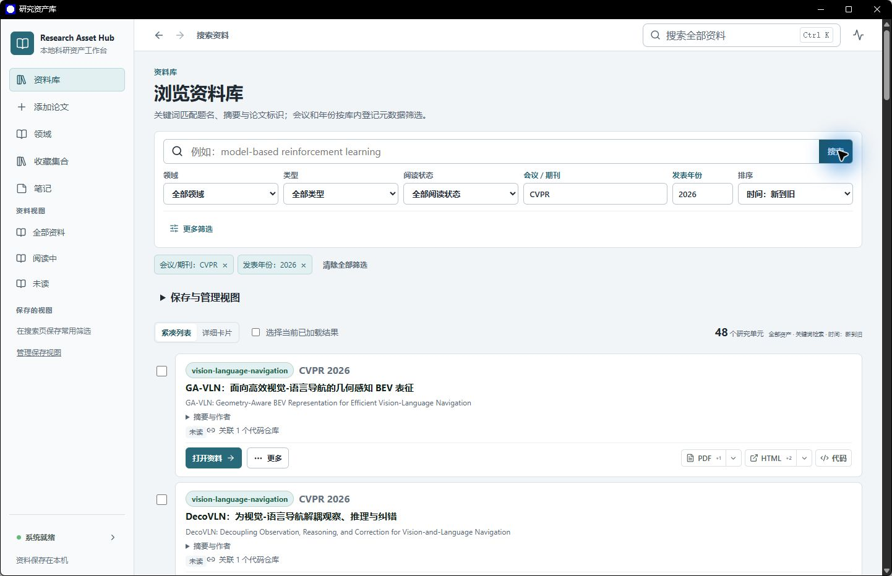

<h1 align="center">研究资产库</h1>

<p align="center"><strong>找到论文，读懂原文，接上代码。</strong></p>
<p align="center">Research Asset Hub · 公开科研资料目录与 Windows 桌面研究工作台</p>

<p align="center">
  <a href="https://research-asset-hub.aurora-coati-0241.chatgpt.site"><strong>浏览公开资料</strong></a> ·
  <a href="https://github.com/fingercd/research-asset-hub-public/releases/tag/v0.3.0-rc.1"><strong>下载 Windows 版</strong></a> ·
  <a href="#快速上手">快速上手</a> ·
  <a href="docs/USER_MANUAL.md">使用手册</a>
</p>

<p align="center">
  <a href="https://github.com/fingercd/research-asset-hub-public/actions/workflows/checks.yml"></a>
  <a href="LICENSE"></a>
  
</p>

---

收藏了论文，却找不到当时的代码？读过一半的长文，下次又得从头翻？

**研究资产库把论文、PDF、代码、导读和阅读记录连在一起。** 你可以先在公开目录里找方向、找论文，也可以在自己的电脑上建立资料库，读原文、查实现、做批注，把零散收藏慢慢变成可持续使用的研究积累。



<p align="center"><sub>真实桌面截图 · 会议、年份与阅读状态筛选，论文和代码在同一处打开</sub></p>

## 不只收藏，更要用起来

- **找资料，不再翻文件夹。** 按关键词、研究领域、会议和年份定位论文；常用筛选可以保存成视图，下次从侧栏直接进入。
- **长论文，接着上次读。** 内置 PDF 阅读器支持页码跳转、缩放、高亮和批注；再次打开时恢复阅读位置，也能切换同一论文的不同版本。
- **论文和实现，对得上。** 相关代码与论文放在一起，可以浏览本地代码目录和文件，或前往原仓库；官方实现与第三方复现分别标明。
- **围绕课题整理，而不只按文件名排序。** 用标签、收藏集合和阅读状态管理材料，批量整理资料，把多篇论文加入对比。
- **从一篇论文，看到一个方向。** 领域总览把资料目录、代表工作和阅读路线放在一起，方便从已有线索继续查阅。
- **让 AI 查库，也能回到证据。** 接入支持 MCP 的 AI 客户端后，可以查询资料、按页读取原文、定位代码；不是只给一段无法核对的回答。[查看接入方法 →](docs/MCP_USER_GUIDE.md)

## 先逛目录，再建立自己的资料库

**[打开公开资料目录 →](https://research-asset-hub.aurora-coati-0241.chatgpt.site)**

不安装也能按关键词、领域、会议和年份浏览已整理的论文条目，跳转到原论文与已登记的代码链接。目录覆盖 Agent、强化学习、世界模型、视觉语言导航、模型微调、AI Infra 等研究方向。

公开目录是注明日期的资料快照，**不托管论文 PDF，不展示个人批注，也不是你的私人资料库的在线镜像**。要保存自己的材料、阅读进度和笔记，请使用桌面版。

## 下载安装

**Windows 10 1903 及以上 / Windows 11 · 64 位 · 首次安装需要联网**

安装前请准备微软的 [Visual C++ x64 运行库](https://learn.microsoft.com/zh-cn/cpp/windows/latest-supported-vc-redist)。已装有兼容版本时无需重复安装。

1. 前往 **[版本下载页](https://github.com/fingercd/research-asset-hub-public/releases/tag/v0.3.0-rc.1)**，选择文件名以 **`x64-setup.exe`** 结尾的安装程序。`Source code` 是源码，不是安装包。
2. 运行安装程序，选择一个新的空安装目录，按向导完成安装。程序会从官方来源下载并校验配套组件，约 **464 MB**；Microsoft WebView2 缺失时还需联网准备。
3. 从开始菜单打开 **研究资产库**，等待初始化完成。首次打开是空资料库，点击 **添加论文** 放入自己的 PDF。日常使用无需另装 Python、Node.js 或数据库。

> 当前提供 **0.3.0-rc.1 在线预览版，只支持首次新安装，不覆盖已有安装**。请先用少量资料试用；干净 Windows 的完整安装、卸载流程尚未实机验收，已验证范围与已知限制见发布说明。

<details>
<summary><strong>我想从源码构建</strong></summary>

需要 Python 3.11+、uv、Node.js 24、pnpm、PowerShell 7，以及 Rust 和 Windows C++ 构建工具。

```powershell
git clone https://github.com/fingercd/research-asset-hub-public.git
cd research-asset-hub
.\scripts\bootstrap.ps1
.\scripts\desktop.ps1 build
```

这一步只构建程序。运行还需要配套运行文件与独立资料目录，请继续按[源码运行指南](docs/DEVELOPMENT.md)操作；制作可分发安装包见[桌面构建说明](desktop/README.md)和[运行文件准备](desktop/scripts/README.md)。

</details>

## 快速上手

### 1. 放进第一篇论文

点击侧栏 **添加论文**，选择 PDF，确认题名与研究领域，完成预览和重复检查，再确认入库。**题名和 PDF 必填**；代码、导读和其他介绍可以以后补。没有合适的领域时，先创建一个名字即可。

### 2. 找到它，开始读

进入 **全部资料**，输入题名或关键词，点击 **打开资料**。可以在原文与代码页签间切换；PDF 有多个版本时，选择需要的版本。阅读时高亮重点、留下批注，下次继续。

### 3. 把它放进自己的研究计划

标成 **未读 / 阅读中 / 已读**，加入某个课题的收藏集合，或与其他论文一起比较。经常查的一组条件可以保存成视图；临时筛选点条件标签上的 **×** 清除。

**想先试一个具体用法？** 选会议 `CVPR`、年份 `2026`，浏览库内相应条目；再加上关键词缩小范围。结果取决于你实际收录的资料，并不是在线搜索整个互联网。

## 也可以让 AI 帮你找

桌面程序启动后，按 [MCP 接入指南](docs/MCP_USER_GUIDE.md)连接你的 AI 客户端，就可以这样提问：

> 找找资料库里关于视觉语言导航压缩的论文，列出题名和原文入口，再看看哪些有关联代码。

> 读取这篇论文的方法部分，给我可以回到原文核对的页码。

AI 接入是可选功能，需单独配置兼容的客户端与模型；它用于查询资料与证据，不会自动运行代码。

## 你可能还想知道

<details>
<summary><strong>原来的资料必须全部搬家吗？</strong></summary>

不需要。已有文件可以保留原位，通过[现有资料加入指南](docs/USER_KNOWLEDGE_BASE_GUIDE.md)登记；新添加的 PDF 也可以由应用保存。原位引用的文件仍需你自己备份，Git 仓库不等于个人资料库备份。

</details>

<details>
<summary><strong>能离线用吗？我的笔记会出现在公开目录里吗？</strong></summary>

已经保存在本机的 PDF 和代码可以离线阅读；访问在线原文和下载新资料需要网络。公开目录与私人桌面库分开，公开站点不提供上传私人资料的入口。将资料交给外部 AI 客户端时，还需遵守该客户端的数据使用设置。

</details>

<details>
<summary><strong>安装以后就有这里展示的全部论文吗？</strong></summary>

不会。公开目录提供论文条目与原站链接，桌面版用于建立你自己的资料库。安装包不捆绑论文原文、第三方完整代码、模型权重或个人数据库；没有代码或导读，也不影响先添加和阅读 PDF。

</details>

## 文档与参与

| 你要做什么 | 从这里开始 |
| --- | --- |
| 学会搜索、阅读、批注和整理 | [使用手册](docs/USER_MANUAL.md) |
| 把现有论文和代码登记进来 | [资料加入指南](docs/USER_KNOWLEDGE_BASE_GUIDE.md) |
| 让 AI 客户端查询本机资料库 | [MCP 接入指南](docs/MCP_USER_GUIDE.md) |
| 查看源码、运行测试或参与改进 | [开发指南](docs/DEVELOPMENT.md) · [贡献说明](CONTRIBUTING.md) |
| 看版本变化、报告问题 | [更新记录](CHANGELOG.md) · [问题反馈](https://github.com/fingercd/research-asset-hub-public/issues) |

更多内容见[文档导航](docs/README.md)。也可以查看[程序介绍海报](docs/images/research-asset-hub-poster.png)；海报是宣传合成图，上方展示的才是真实桌面截图。

## 许可证与资料来源

项目原创源码采用 **[MIT 许可证](LICENSE)**。论文、摘要、第三方代码及依赖保留各自的版权与许可，**不因收录进目录而变成 MIT 内容**。公开目录仅提供检索线索与来源链接，获取和使用原文、代码时请遵守原站要求。详见[资料来源与公开范围](DATA_SOURCES.md)。
