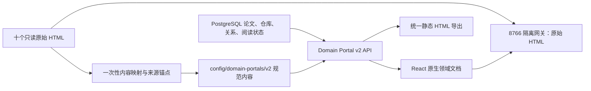

# 领域门户 v2：主页面一体化与十领域内容统一实施计划

> 日期：2026-07-26
> 项目：Research Asset Hub
> 范围：10 个现有研究领域的详情页、统一领域内容契约、统一 HTML/视觉体系、原始 HTML 保留与发布验收
> 当前阶段：计划完成，尚未开始实施

## 1. 对需求的准确理解

本轮目标不是继续放大当前 iframe，也不是仅给十个不同的原始 HTML 再覆盖一层 CSS，而是完成两层真正的一体化：

1. **页面一体化**
   - 进入 `/domains/<slug>` 后，领域内容直接成为右侧工作区的主页面。
   - 当前位于 HTML 上方的标题、领域说明、论文/仓库/研究单元/阅读中统计，以及“领域总览 / 研究单元 / 最近更新 / 统计”导航，都必须成为同一个领域文档的页头组成部分。
   - 默认页面不再出现“领域整体 HTML”卡片、卡片标题、状态条、内层边框和双重滚动条。
   - Hub 左侧导航和顶部全局搜索继续保留。

2. **内容与风格一体化**
   - 十个领域使用完全一致的一级目录、稳定锚点、组件语义、排版、间距、颜色、交互和响应式规则。
   - 每个领域都必须包含“发展时间线”“能力与方法版图”“推荐阅读路线”等核心内容；内容仍然是各自领域的事实、论文、方法、任务、数据集和判断。
   - 以世界模型的时间线、游戏 RL 的能力与方法版图、强化学习的阅读路线为主要内容原型，同时吸收 WSVAD 的数据集/指标矩阵。
   - 不改写、移动、覆盖或删除十个原始入口 HTML；统一版是平台维护的规范化领域文档，原始 HTML 仍作为可追溯证据单独打开。

## 2. 完成定义

实施完成后必须同时满足：

- 首页继续动态显示全部领域；点击任一领域后，右侧主内容直接从领域文档页头开始。
- 默认领域页的 DOM 中不存在用于展示统一版内容的 iframe；原始 HTML 仅在用户点击“查看原始 HTML”时通过隔离网关打开。
- 论文/仓库/研究单元/阅读中四项统计和四个一级视图 tab 都位于同一个 `<article data-domain-portal>` 内。
- 四个一级视图统一为：
  - `领域总览`
  - `研究单元`
  - `最近更新`
  - `统计`
- 十个领域的“领域总览”均按相同顺序提供九个固定章节；不得用改名或换序制造表面一致。
- 时间线、能力与方法版图、阅读路线均有本领域真实内容，不允许用空模板、跨领域复制或无证据的自动生成文字充数。
- 现有论文、仓库、表示、批注、阅读状态和关系数据不迁移、不重写；所有动态数字继续以 PostgreSQL 为准。
- 十个原始入口 HTML 以及所有被 v2 映射读取的子页、JSON、CSS 和其他来源文件，其 SHA-256、大小和 mtime 前后完全一致。
- 每个原始 H2/H3 章节均有迁移结局：进入统一章节、合并为去重内容、保留在领域附录，或明确记录为“仅原始版保留”；零静默遗漏。
- 桌面和窄屏均只有页面级主滚动，360px 宽度无横向溢出。
- 所有十个领域通过内容契约、API、前端、Playwright、axe、静态导出和来源完整性门禁后才切换为默认 v2。

## 3. 当前基线与差异

当前详情页由 `apps/web/src/pages/DomainsPage.tsx` 组合：

1. `PageHeader`
2. 独立 `.domain-hero-stats`
3. 独立 `.domain-tabs`
4. `DomainOverviewPanel`
5. 带工具栏、状态条、边框和固定高度的 iframe

`DomainOverviewPanel` 通过 `/api/v1/representations/{id}/open-actions` 获取 8766 网关签名地址。网关在响应时只注入 `research-theme-v1.css`，因此只能统一基础颜色和字体，无法把十套不同的目录、信息架构和内容颗粒度变成同一种领域页面。

当前十领域的主要差异如下：

| 领域 | 现有优势 | 需要补齐或重排 |
|---|---|---|
| Agent | 已有时间线、模块、阅读路径、证据状态子页 | 首页只有搜索；需把子页内容合并为一个完整总览，并补能力—方法矩阵 |
| Infra | 演进、跨层约束、训练/服务主线、阅读路线较完整 | 统一为固定章节；补显式能力—方法矩阵和任务/评测口径 |
| 世界模型 | 范围、六模块、时间线、技术路线、精读清单最接近目标 | 作为时间线模板；补统一任务/数据集/评测章节和开放问题格式 |
| 强化学习 | 范式迁移、里程碑、方法树和多条阅读路线完整 | 作为阅读路线模板；将方法树规范化为能力—方法矩阵 |
| 大模型微调 | 结论、三轴分类、演进、选型和阅读路径较完整 | 调整到统一顺序；补评测矩阵、代表工作和开放问题 |
| 图像与视频生成 | 双路线时间线、阅读路径、论文库 | 内容最薄；需补能力—方法版图、数据集/指标、代表工作和趋势边界 |
| 大厂技术报告 | 技术主线、时间线、机构矩阵、阅读路线 | 将机构维度放入领域附录；补统一能力—方法版图和评测/证据章节 |
| VLN | 热门方向、时间线、阅读路径、课程映射 | 补能力—方法版图、任务/数据集/指标矩阵；课程映射进入领域附录 |
| 游戏 RL | 时间线、研究重心、能力与方法版图、阅读路径 | 作为能力—方法版图模板；补统一评测矩阵和证据边界 |
| WSVAD | 阶段、时间线、趋势、阅读路线、数据集与指标 | 作为评测矩阵模板；补显式能力—方法版图 |

## 4. 锁定的架构决策

### 4.1 统一版使用结构化领域文档，不向任意原始 HTML 强行注入动态页头

采用“平台规范化领域文档”方案：



原因：

- 原始 HTML 的 CSS、脚本、CSP、DOM 和导航差异很大，运行时强注入页头无法保证十领域一致。
- 直接把原始 HTML `fetch` 后通过 `dangerouslySetInnerHTML` 放进主站会破坏现有安全边界。
- 结构化领域文档可以直接在 React 主页面中渲染，彻底消除卡片感、双滚动和 iframe 尺寸问题。
- 原始 HTML 继续走 8766 签名网关，满足只读、可追溯和原交互保留。
- 同一领域文档契约还可以确定性生成统一的离线 HTML，满足数字资产导出需求。

### 4.2 默认统一版与原始版的关系

- `/domains/<slug>` 默认渲染 v2 统一领域文档。
- “查看原始 HTML”是二级操作，通过 API 创建短时签名会话后在新窗口打开。
- 原有 `presentation=hub|original` 合同继续保留给历史 HTML；它不再承担 v2 内容统一职责。
- v2 内容无效或缺失时，页面显示明确错误和原始 HTML 入口；开发期允许 legacy fallback，正式切换时十领域不得依赖 fallback。

### 4.3 不新增数据库迁移作为默认路径

领域叙述、时间线、方法图和阅读路线属于版本控制的策展内容，放在 `config/domain-portals/v2/`，随配置一起备份。论文、关系、阅读状态和表示可用性仍从 PostgreSQL 动态读取。

只有实际实现发现现有审计/索引模型无法记录 v2 内容版本时，才允许增加窄范围迁移；不得为了保存可重建 HTML 新建大表。

## 5. 统一领域内容契约

### 5.1 每个领域完全相同的文件结构

```text
config/domain-portals/v2/
├── portal-index.yaml
├── agent/
│   ├── portal.yaml
│   ├── overview.md
│   ├── timeline.yaml
│   ├── capability-method-map.yaml
│   ├── landmarks.yaml
│   ├── reading-routes.yaml
│   ├── benchmarks.yaml
│   └── open-questions.md
├── infra/
│   └── 同上
└── ...其余八个领域完全同构
```

规则：

- 不允许某个领域通过增加任意文件改变核心目录。
- 领域特有内容写入 `portal.yaml` 的 `appendices`，不能插入或改名核心章节。
- 不适用的 `benchmarks` 必须使用 `status: not_applicable` 并说明原因，不能省略文件。
- 所有路径均为项目内相对路径，不允许本机绝对路径。
- 论文、仓库、PDF、HTML 和导读使用稳定 `asset_id` / `representation_id` 引用，不手写本机路径。
- `portal-index.yaml` 是 v2 唯一动态注册表；每项必须声明 slug、标签、内容目录、原始入口的稳定来源选择器、允许的严格挂载白名单和默认展示策略。
- v2 配置不得手写无法恢复的临时 URL，也不得只依赖可能被合并重定向的 representation UUID。
- 每个 `portal.yaml` 必须记录 `source_inputs`：所有映射来源的稳定选择器、导入时 digest，以及 `section-mapping.json` 的 mapping digest。
- 加载器发现当前来源 digest 或 mapping digest 与已审版本不一致时，返回 `stale: true`、列出 `stale_reasons`，并把受影响块降为 `needs_review`；页面显著提示，发布门禁失败，但仍保留原始 HTML 入口。

### 5.2 固定九章节及稳定锚点

所有领域按以下顺序渲染：

| 顺序 | 稳定 ID | 统一标题 | 内容要求 |
|---|---|---|---|
| 1 | `scope` | 领域定位与边界 | 一句话定义、纳入/排除范围、核心问题、资料覆盖口径 |
| 2 | `timeline` | 发展时间线 | 阶段、问题转折、代表方法、代表论文和年份 |
| 3 | `capability-method-map` | 能力与方法版图 | 能力轴、方法轴、任务/环境轴及其对应关系 |
| 4 | `landmarks` | 代表工作与技术路线 | 里程碑论文、为何重要、承前启后关系 |
| 5 | `benchmarks` | 任务、数据集与评测 | 任务设定、数据集/环境、指标、不可直接比较的边界 |
| 6 | `reading-routes` | 推荐阅读路线 | 3–5 条路线、目标、前置知识、阅读顺序、选择理由 |
| 7 | `catalog` | 论文、代码与导读目录 | 总览只显示覆盖摘要、代表入口和“查看全部”；完整列表在研究单元 view 中按 30 条分页 |
| 8 | `frontiers` | 前沿趋势与开放问题 | 当前问题、证据强弱、仍待验证的研究判断 |
| 9 | `evidence` | 证据、来源与版本说明 | 来源、缺失项、候选关系、内容版本、更新时间和原始 HTML |

`领域总览`展示上述九章；`研究单元`、`最近更新`、`统计`使用同一文档页头，但只切换正文区域。

### 5.3 内容类型

新增 `research-asset-hub.domain-portal/v2` JSON Schema，核心类型包括：

- `DomainPortalDocument`
- `DomainPortalMetadata`
- `PortalNavigationItem`
- `TimelineStage`
- `CapabilityDefinition`
- `MethodDefinition`
- `CapabilityMethodCell`
- `LandmarkItem`
- `ReadingRoute`
- `ReadingStep`
- `BenchmarkRow`
- `PortalEvidenceRef`
- `PortalReviewState`

每个叙述性块必须带：

```yaml
id: foundation-model-turn
status: reviewed
summary: "基础模型使该领域从专用策略转向通用感知、推理与行动接口。"
asset_ids:
  - "<stable-asset-uuid>"
evidence:
  - asset_id: "<stable-asset-uuid>"
    source_id: "<stable-source-id>"
    source_record_id: "<stable-source-record-id>"
    source_record_version_digest: "<sha256-or-null>"
    representation_id: "<stable-representation-uuid>"
    representation_digest: "<sha256-or-tree-digest>"
    anchor:
      kind: html_heading
      heading: "..."
      dom_locator: "..."
```

证据引用规则：

- `asset_id`用于当前库内跳转，加载器必须跟随永久 redirect。
- `source_id + source_record_id`或强外部标识是数据库恢复后的稳定来源选择器。
- `representation_digest`必须与当前表示的 `sha256` / `tree_digest` 一致。
- anchor 必须是现有判别式 Anchor：PDF 页/坐标、HTML heading/DOM locator、文本行，或代码 revision/path/行范围。
- 导出和发布时必须验证表示可用性、digest 和 anchor；任一不一致时自动把对应内容降为 `needs_review`，不得继续以 `reviewed` 发布。

状态只允许：

- `generated`：由规则或模型生成，尚未人工/证据校核。
- `reviewed`：已核对资产与证据，可进入正式页面。
- `not_applicable`：该领域明确不适用，并有说明。
- `needs_review`：存在冲突或证据不足；正式发布门禁不允许核心块保留此状态。

### 5.4 自动数据与策展内容边界

由正式库实时生成：

- 论文、仓库、研究单元、阅读状态和批注数量。
- 完整研究单元目录、representation 可用状态和快捷操作。
- 年份分布、类型分布、表示覆盖率和最近更新。
- 已确认论文—仓库关系。

由规则生成候选、再进行证据校核：

- 时间线阶段划分。
- 能力、方法和任务标签聚类。
- 里程碑候选。
- 阅读路线候选。

必须校核后发布：

- 技术转折的因果叙述。
- 为什么某篇论文是里程碑。
- 能力—方法对应关系。
- 阅读顺序和前置知识。
- 数据集/指标的可比性判断。
- 趋势与开放问题。

模型可辅助起草，但每项事实必须引用本库资产；证据不足时写明“不足”，不能补写看似完整的结论。

## 6. 页面和交互规范

### 6.1 主路由

领域页采用：

```text
/domains/<slug>?view=overview
/domains/<slug>?view=units
/domains/<slug>?view=recent
/domains/<slug>?view=stats
/domains/<slug>?view=overview#timeline
```

- 默认 `view=overview`。
- tab 切换写入 URL，支持刷新、前进/后退和直接分享本机链接。
- 九章使用 hash 锚点。
- 未知 `view` 回退 `overview`，未知 slug 返回现有 404。

### 6.2 领域文档页头

`<article data-domain-portal>` 内按固定顺序包含：

1. 返回领域目录。
2. 领域 slug、中文名、说明和最近更新时间。
3. 论文、仓库、研究单元、阅读中四项实时统计。
4. “领域总览 / 研究单元 / 最近更新 / 统计”一级 tab。
5. “搜索此领域”和“查看原始 HTML”操作。
6. 总览视图内的九章目录。

这些元素不再由 `PageHeader`、`.domain-hero-stats` 和 `.domain-tabs` 三块独立卡片拼接。

### 6.3 视觉规范

统一样式以现有 Hub 的清晰绿色系为基础：

- 单一浅色阅读主题；原始 HTML 可保留自身主题。
- 主文档无外层卡片边框，背景与右侧工作区连续。
- 正文最大宽度、时间线宽度、矩阵列数和段落长度统一。
- 时间线统一为“阶段说明 + 代表论文 + 方法变化”的纵向组件。
- 能力与方法版图统一为可折叠矩阵；窄屏转为按能力分组的列表。
- 阅读路线统一显示目标、前置知识、步骤、预计篇数和路线理由。
- 表格在窄屏使用受控横向滚动，只允许表格自身滚动，不允许页面整体溢出。
- 不增加装饰性动画；尊重 `prefers-reduced-motion`。
- 所有交互拥有键盘焦点、可读标签和足够颜色对比度。

### 6.4 数据加载

- 进入领域页只加载领域文档和首屏统计。
- `研究单元` tab 激活后才请求空关键词、`group_by=paper` 的首批 30 个单元。
- `最近更新`只加载 5 项。
- `统计`使用聚合接口，不把完整论文目录一次性塞入初始响应。
- 内容响应携带 `content_digest`，但动态统计与阅读状态接口使用 `Cache-Control: no-store`；前端通过 React Query 内存缓存和写操作后的显式失效控制重取，v2 不使用无缓存 payload 支撑的 HTTP `304`。

## 7. 公共接口调整

新增：

```text
GET /api/v1/domains/{slug}/portal
```

返回：

```json
{
  "schema": "research-asset-hub.domain-portal/v2",
  "slug": "world-model",
  "label": "世界模型",
  "content_version": "2026-07-26.1",
  "content_digest": "...",
  "updated_at": "...",
  "review_status": "reviewed",
  "stale": false,
  "stale_reasons": [],
  "metrics": {
    "papers": 46,
    "repositories": 35,
    "research_units": 46,
    "reading": 0
  },
  "views": ["overview", "units", "recent", "stats"],
  "sections": [],
  "original_overview": {
    "source_id": "domain-portals-20260726",
    "source_record_id": "overview:world-model",
    "representation_id": "...",
    "representation_digest": "...",
    "status": "available"
  }
}
```

接口规则：

- 不返回本机绝对路径。
- 内容文件未通过 schema 时返回 `application/problem+json`，错误码为 `domain_portal_invalid`。
- 无原始 HTML 时统一版仍可工作，只把原始入口标记为 `not_provided`。
- `original_overview.representation_id` 只能用于既有 open-action API。
- 前端仅在 `original_overview.status == available` 时允许请求 open-action；`missing`、`not_provided`、`network_required`、`unavailable` 或 v2 stale 警告均显示对应原因，不向不可用表示发送打开请求。
- 响应返回确定性的 `content_digest` 供审计和前端变更判断；由于响应包含动态统计，不启用条件式 `304`。
- 阅读状态、批注、关系和 representation 变更后，前端必须同时失效 `domain`、`domain-portal` 和受影响的 `search` query key。
- 当前 source/mapping digest 与 `portal.yaml.source_inputs` 不一致时，接口返回 `stale=true`，不得继续把内容报告为 `reviewed`。
- `/api/v1/domains/{slug}` 保持兼容；现有调用无需同步修改。
- 研究单元继续复用 `/api/v1/search?q=&group_by=paper&domain=<slug>`，不复制搜索逻辑。

前端新增类型：

- `DomainPortalDocument`
- `DomainPortalView`
- `DomainPortalSection`
- `TimelineStage`
- `CapabilityMethodMap`
- `ReadingRoute`
- `PortalEvidenceRef`

## 8. 任务拆解

### 任务 1：冻结基线并建立完整迁移映射

**涉及文件或模块：**

- 新建：`work/domain-portal-v2/baseline.json`
- 新建：`work/domain-portal-v2/section-mapping.json`
- 使用：`config/intake/domain-portals-20260726/manifest.json`
- 使用：十个只读原始入口 HTML

**实施内容：**

- 记录十个入口 HTML 的路径、SHA-256、大小、mtime、标题、H1/H2/H3、导航、内部锚点、CSS/JS 依赖和主要子页。
- Agent 领域额外盘点 `timeline/`、`modules/`、`reading/` 和 `evidence/` 子页。
- 给每个现有 H2/H3 建立迁移结局：
  - `mapped`
  - `merged_duplicate`
  - `appendix`
  - `original_only`
- `original_only` 必须填写原因。

**验收标准：**

- 十个入口和已使用子页全部进入基线。
- 所有原始 H2/H3 映射覆盖率为 100%。
- 不修改任何来源文件。

### 任务 2：建立 v2 Schema、统一目录和校验器

**涉及文件或模块：**

- 新建：`docs/schemas/domain-portal-v2.schema.json`
- 新建：`config/domain-portals/v2/portal-index.yaml`
- 新建：`config/domain-portals/v2/<slug>/` 十个同构目录
- 新建：`packages/domain_portals/schemas.py`
- 新建：`packages/domain_portals/loader.py`
- 新建：`scripts/validate_domain_portals.py`
- 测试：`tests/contract/test_domain_portal_v2.py`

**实施内容：**

- 使用 Pydantic 判别联合定义九种章节和证据引用。
- 校验 slug、固定章节顺序、稳定 ID、重复 ID、非法路径、无效资产引用和 review 状态。
- `portal-index.yaml` 动态列出领域，并保存原始入口的稳定来源选择器与严格挂载白名单；新建第 11 个领域不再修改 Python `PORTALS` 常量。
- `portal.yaml.source_inputs`保存原始入口/子页 digest 和 mapping digest，并参与 `content_digest` 计算。
- 保留 `scripts/build_domain_portal_snapshot.py` 作为冻结 v1 证据，不重写旧 manifest；v2 使用新加载器。

**验收标准：**

- 十领域目录结构完全一致。
- 删除任一必需文件、调换章节顺序或写入绝对路径时校验失败。
- 修改任一映射来源但不更新内容审查和 mapping digest 时，校验结果必须变为 stale。
- 新增合成第 11 个领域无需修改核心代码，但测试必须完整走通：注册只读来源及 canonical snapshot/formal import、增加 taxonomy 和 `portal-index.yaml` 注册项、新增同构内容目录、生成/导入门户 sidecar，并通过 schema、来源完整性、严格挂载和静态导出校验。

### 任务 3：用三个样板封板统一内容模型

**样板领域：**

- 世界模型：时间线。
- 游戏 RL：能力与方法版图。
- 强化学习：推荐阅读路线。

**涉及文件或模块：**

- 修改：三个对应的 `config/domain-portals/v2/<slug>/` 目录。
- 新建：`work/domain-portal-v2/pilot-review.json`

**实施内容：**

- 从原始 HTML 和正式库提取现有内容，先完成三个样板。
- 时间线每阶段必须包含问题、方法转折和代表资产。
- 能力与方法版图至少包含能力轴、方法轴、任务/环境轴和有证据的交叉单元。
- 每条阅读路线包含目标、前置知识、3–12 个步骤及选择理由。
- 用统一字段表达，不把原 HTML 的 CSS class 或 DOM 结构带入内容契约。

**验收标准：**

- 三个样板九章齐全，核心块全部为 `reviewed`。
- 引用资产全部能在正式库打开。
- 无跨领域误引、无不存在的资产 ID。
- 样板通过后冻结 schema 和主要组件，不在迁移其余领域时随意改结构。

### 任务 4：迁移和补齐其余七个领域

**涉及文件或模块：**

- 修改：Agent、Infra、微调、生成、技术报告、VLN、WSVAD 对应内容目录。
- 新建：`work/domain-portal-v2/content-review.json`

**实施内容：**

- Agent：合并分散子页，保留时间线、模块、阅读路径和证据内容。
- Infra：把训练、Serving、网络、并行、内存、编译和调度整理成能力—方法矩阵。
- 微调：把三轴分类映射为能力—方法矩阵，补任务/评测和路线理由。
- 生成：建立 VAE/GAN/自回归/扩散/流匹配与图像/视频/可控生成能力矩阵，补指标边界。
- 技术报告：把机构矩阵作为附录，核心正文仍按统一九章组织。
- VLN：补任务、环境、数据集、指标和空间感知/规划/记忆/基础模型能力矩阵。
- WSVAD：保留数据集/指标优势，补表征、MIL、自训练、VLM、定位和开放世界能力矩阵。

**验收标准：**

- 十领域所有核心块均为 `reviewed` 或明确 `not_applicable`。
- 0 个核心块为 `generated` / `needs_review`。
- 每条事实性判断至少有一个资产或表示证据。
- 原始章节映射报告无未解释遗漏。

### 任务 5：实现领域文档 API 和静态导出

**涉及文件或模块：**

- 新建：`packages/domain_portals/service.py`
- 新建：`packages/exporting/domain_portal.py`
- 修改：`apps/api/routes_v1.py`
- 修改：`apps/api/serialization.py`
- 修改：`packages/exporting/catalog.py`
- 新建：`scripts/render_domain_portals.py`
- 新建：`apps/web/scripts/render-domain-portals.tsx`
- 新建：`apps/web/src/components/domain-portal/StaticDomainPortalDocument.tsx`
- 修改：`apps/web/package.json` 与 lockfile（锁定 `tsx` 构建依赖）
- 测试：`tests/api/test_domain_portal_v2.py`
- 测试：`tests/exporting/test_domain_portal_v2.py`

**实施内容：**

- 加载并缓存已验证内容，合并 PostgreSQL 实时统计。
- 解析 asset redirect，拒绝悬空或软删除引用。
- 使用 `source_id + source_record_id`解析原始表示和证据；representation ID 只作为已解析结果返回，不能成为唯一恢复键。
- importer 完成、原始门户 digest 变化或 mapping 更新时，通过 outbox 排队 `domain_portal.validate` / `domain_portal.generate`；任务幂等，并显式报告 stale 而不是自动伪造新叙述。
- 静态导出写入：

```text
outputs/open-catalog/by-domain/<slug>/portal/
├── index.html
├── portal.json
└── assets/
    └── domain-portal-v2.css
```

- 静态导出与主站使用相同章节顺序、稳定 ID 和设计 token。
- Python 导出层只生成已验证的 `portal.json`；HTML 由 `react-dom/server` 的 `renderToStaticMarkup` 和与主站相同的 `PortalSectionRenderer` 生成。
- Markdown 在主站和静态导出中均只经过现有 `react-markdown + rehype-sanitize`；不在 Python 中实现第二套 Markdown 解析器。
- 静态 HTML 不执行脚本，四个 view 以普通锚点/完整阅读快照呈现；交互式分页只属于正在运行的 Hub。
- 静态 HTML 不包含短时 token、本机路径、外部脚本、事件处理器或未清洗的原始 HTML。
- 静态导出的“查看原始 HTML”只链接稳定 Hub 路由 `/domains/<slug>?open=original`，并标注“需运行 Hub”；React 收到该参数后才调用 open-action。离线打开静态文件时只展示原始来源元数据，不承诺直接访问 8766。

**验收标准：**

- API 十领域均返回 200、确定性的 `content_digest`、`Cache-Control: no-store` 和一致 schema。
- 静态导出重复运行字节稳定；只有 `generated_at` 等明确字段允许变化。
- 动态统计与正式数据库一致。
- 原始 HTML 表示 ID 可用但路径不可见。
- 修改一份复制的源 digest 后 API/生成器必须报告 stale；更新映射并重新审查后 stale 清除。

### 任务 6：把领域文档原生渲染为主页面

**涉及文件或模块：**

- 修改：`apps/web/src/pages/DomainsPage.tsx`
- 新建：`apps/web/src/components/domain-portal/DomainPortal.tsx`
- 新建：`apps/web/src/components/domain-portal/DomainPortalHeader.tsx`
- 新建：`apps/web/src/components/domain-portal/DomainPortalNavigation.tsx`
- 新建：`apps/web/src/components/domain-portal/PortalSectionRenderer.tsx`
- 新建：`apps/web/src/components/domain-portal/ScopeSection.tsx`
- 新建：`apps/web/src/components/domain-portal/TimelineSection.tsx`
- 新建：`apps/web/src/components/domain-portal/CapabilityMethodMap.tsx`
- 新建：`apps/web/src/components/domain-portal/LandmarksSection.tsx`
- 新建：`apps/web/src/components/domain-portal/ReadingRoutes.tsx`
- 新建：`apps/web/src/components/domain-portal/BenchmarkMatrix.tsx`
- 新建：`apps/web/src/components/domain-portal/CatalogSection.tsx`
- 新建：`apps/web/src/components/domain-portal/FrontiersSection.tsx`
- 新建：`apps/web/src/components/domain-portal/EvidenceSection.tsx`
- 修改或退役：`apps/web/src/components/DomainOverviewPanel.tsx`
- 修改：`apps/web/src/api/client.ts`
- 修改：`apps/web/src/api/types.ts`
- 新建：`apps/web/src/api/queryInvalidation.ts`
- 测试：`apps/web/src/api/queryInvalidation.test.ts`
- 修改：`apps/web/src/styles.css`

**实施内容：**

- `DomainDetailPage`只负责 slug、view、query 和错误边界。
- `DomainPortal`渲染整篇 `<article>`；页头、统计、一级 tab 和九章目录全部在 article 内。
- `PortalSectionRenderer`必须对九种判别联合逐项穷尽匹配；未知 kind 在 TypeScript 编译期失败，运行时显示可见问题而不是静默跳过。
- 删除默认路径上的 `PageHeader`、独立 hero stats、独立 tab 卡和 `DomainOverviewPanel` iframe。
- `研究单元`继续复用 `ResearchUnitCard` 和 cursor 分页。
- 总览中的 `catalog`章节只显示覆盖摘要、代表研究单元和“查看全部”；完整 30 条分页只在 `view=units` 激活后请求。
- `最近更新`与`统计`继续使用现有数据，但作为同一文档正文切换。
- Markdown 通过现有 `react-markdown + rehype-sanitize` 渲染；不允许 raw HTML。
- “查看原始 HTML”只在 `status=available` 时调用现有 open-action；其他状态显示“缺失 / 未提供 / 需联网 / 不可用 / 统一内容已过期”的具体原因。
- `/domains/<slug>?open=original`负责从稳定 Hub 链接申请一次签名会话；成功或失败后清理该参数，避免刷新时重复打开。
- 所有 reading-state、annotation、relation、representation 和 asset mutation 统一调用 `queryInvalidation.ts`；helper 根据受影响 asset/domain 集中执行 `QueryClient.invalidateQueries`，禁止各页面零散维护不完整的 key 列表。

**验收标准：**

- 默认领域页没有 iframe、卡片外框和双滚动。
- 统计与一级 tab 只出现一次，且属于 `data-domain-portal`。
- 切换任一 view 时文档页头保持不变。
- 原始 HTML 仍能安全打开，统一版失败时有明确错误。
- 更新阅读状态、添加批注或确认关系后，无需手动刷新即可更新领域统计、目录摘要和搜索 facets。

### 任务 7：统一视觉、响应式和无障碍

**涉及文件或模块：**

- 新建：`apps/web/src/domain-portal-v2.css`，或在 `styles.css` 中建立独立层。
- 修改：`apps/asset_gateway/static/research-theme-v1.css`，仅做原始 HTML 的兼容性维护。
- 测试：`apps/web/src/components/domain-portal/*.test.tsx`
- 测试：`apps/web/e2e/app.spec.ts`

**实施内容：**

- 统一时间线、能力矩阵、路线卡、里程碑、评测表和证据状态。
- 删除 `.domain-overview-panel`、`.domain-overview-frame-shell` 等默认视图依赖；legacy fallback 可暂留一版。
- 对 360px、768px、1440px 三档布局定义明确规则。
- tab 支持方向键、Home、End；锚点滚动考虑 sticky topbar 偏移。
- 给图表/矩阵提供文本等价表示。

**验收标准：**

- 十领域同类组件视觉参数一致。
- 页面级横向溢出为 0。
- axe serious/critical 为 0。
- 键盘可完成 view 切换、章节导航、研究单元打开和原始 HTML 打开。

### 任务 8：回归、安全、备份与切换

**涉及文件或模块：**

- 修改：`tests/api/test_v1.py`
- 修改：`tests/runtime/test_gateway.py`
- 修改：`tests/integrations/test_html_audit.py`
- 修改：`tests/ingestion/test_source_integrity.py`
- 修改：`apps/web/src/pages/DomainsPage.test.tsx`
- 修改：`apps/web/e2e/app.spec.ts`
- 修改：`apps/api/config.py`（开发期 renderer feature flag）
- 修改：`docs/USER_MANUAL.md`
- 修改：`docs/USER_KNOWLEDGE_BASE_GUIDE.md`
- 修改：`docs/AGENT_KNOWLEDGE_BASE_PLAYBOOK.md`
- 修改：`outputs/release/release-report.*`

**实施内容：**

- 开发期增加 `domain_portal_renderer=v1|v2` 配置；十领域全部验收后默认切到 v2。
- 切换前建立 Restic 恢复点。
- 重跑十个原始 HTML 的 Hub/original 网关测试，证明历史入口未被破坏。
- 对任务 1 中所有被读取的来源文件逐项复核 SHA-256、大小和 mtime，不把范围缩小到十个入口。
- 验证“来源 digest 改变 → stale / needs_review → 重新映射和校核 → stale 清除”的完整状态流。
- 将统一门户目录规范写入用户和后续 Agent 指南。
- 发布报告增加内容完整性、证据引用、静态导出和视觉一致性章节。
- 隔离恢复演练必须断言：
  - `config/domain-portals/v2/**` 与 `portal-index.yaml` 的 tree digest 一致。
  - 十个 `outputs/open-catalog/by-domain/<slug>/portal/` 均包含 `index.html`、`portal.json` 和 assets。
  - `portal.json` 的 `content_digest`、schema 与 generator version 和恢复后的配置一致。
  - 恢复库中的资产、表示、来源选择器和证据锚点全部可解析。
  - 从恢复的 config + PostgreSQL 重新导出后，除允许的时间字段外与恢复的静态导出等价。

**验收标准：**

- v2 切换后十领域全部可打开，无 legacy fallback。
- 原始来源完整性 100%。
- 恢复演练能够恢复配置、数据库和统一静态 HTML 导出。
- 工作区测试、发布报告和备份均无关键失败。

## 9. 自动验证矩阵

### Python

```powershell
.\.venv\Scripts\ruff.exe check apps packages scripts tests
.\.venv\Scripts\mypy.exe --strict apps packages scripts
.\.venv\Scripts\python.exe -m pytest -q
```

重点断言：

- 十个内容目录 schema 全通过。
- 九章节顺序固定且 ID 唯一。
- 所有资产/表示引用可解析。
- 原始入口 hash、mtime 未变化。
- API `content_digest`、`Cache-Control: no-store`、问题详情、query 失效行为和无本机路径泄漏。
- source/mapping digest 变化后的 stale 状态、生成任务去重和重新校核行为。
- 静态 HTML 确定性、无脚本注入、无悬空内部锚点。

### 前端

```powershell
npm --prefix apps/web run lint
npm --prefix apps/web run typecheck
npm --prefix apps/web run test
npm --prefix apps/web run build
npm --prefix apps/web run test:e2e
```

重点断言：

- 十领域默认均渲染统一 article。
- 页头、统计和 tab 属于领域文档且只出现一次。
- 四 view URL、前进后退和 hash 锚点正确。
- 总览不会请求完整 catalog；只有进入 `view=units` 才请求首批 30 条并继续 cursor 分页。
- 研究单元可加载到最后一页且无重复。
- 原始 HTML 使用签名 URL，不暴露路径。
- `available` 原始表示可打开；`missing`、`not_provided`、`network_required`、`unavailable` 和 stale 场景不发 open-action，并显示对应文案；无效或过期 token 返回可见错误。
- 静态导出的稳定 `/domains/<slug>?open=original` 链接由 React 换取短时签名，静态文件本身不保存 token。
- 主站和静态导出对同一 Markdown fixture 生成相同章节 ID、链接、允许标签和可见文字；危险 HTML 均被清除。
- reading-state、annotation、relation、representation 和 asset mutation 均触发统一 query invalidation，动态统计和搜索 facets 在下一次读取时立即一致。
- 360px、768px、1440px 无溢出、无双滚动。
- 十领域真实页面无 console error、page error、失败资源和空白区域。

### 内容质量

- 原始 H2/H3 映射覆盖率：100%。
- 核心章节完整率：10/10 × 9/9。
- 核心 `needs_review`：0。
- 事实性块证据覆盖率：100%。
- 悬空资产/表示引用：0。
- 跨领域误引：0。
- 论文/仓库/研究单元数量与 API 不一致：0。

## 10. 发布硬门槛

- 十个领域主页面均不使用默认 iframe。
- 十个领域均有非空的发展时间线、能力与方法版图、推荐阅读路线。
- 九章标题、顺序、锚点和组件类型一致。
- 统计条和四个 view tab 位于领域文档自身。
- 原始 HTML 均能单独打开，且所有被 v2 读取的来源文件 hash/大小/mtime 完全不变。
- 统一静态 HTML 导出 10/10 成功。
- 页面、API、网关、内容契约、响应式和无障碍测试全部通过。
- 零关键失败、零静默内容丢失、零无效证据链接。
- 完成一次切换前备份和独立恢复演练。

## 11. 风险与控制

| 风险 | 控制 |
|---|---|
| 只统一 CSS，内容仍不一致 | schema 固定九章、固定顺序和内容类型 |
| 自动生成看似完整但事实错误 | 核心块发布前必须 `reviewed` 且有资产证据 |
| 迁移时遗漏原 HTML 内容 | H2/H3 逐项映射，100% 结局覆盖 |
| 主页面再次出现双滚动 | v2 原生 React DOM；原始 iframe 不在默认路径 |
| 统一版与数据库数字过期 | 统计、目录、最近更新实时从 API 获取 |
| 原始页面交互被破坏 | 原始表示不变，继续由 8766 网关独立打开 |
| 第 11 个领域仍需改核心代码 | `portal-index.yaml` + schema 驱动，不硬编码 slug |
| 内容配置损坏导致全页空白 | 启动前校验、API problem response、可见 fallback |
| 静态导出与主站样式漂移 | 共用设计 token、稳定 class 和视觉回归快照 |

## 12. 默认假设与非目标

- “HTML 成为页面主题”按“统一领域文档直接成为右侧主 DOM”实施，不把来源 HTML 原样注入主站。
- 现有十个原始 HTML 均视为不可变证据；本轮只读取和映射。
- 本轮不重写所有逐篇论文 HTML，只统一十个领域级总览文档。
- 本轮不下载缺失论文、不修改论文/仓库关系、不改变阅读状态和批注数据。
- 本轮不公开部署，仍只监听 `127.0.0.1`。
- 内容补齐优先使用当前资料库；需要模型辅助时只发送必要片段，并遵循既有预算和证据规则。
- 统一版采用实用、清晰、克制的视觉风格，不加入装饰性特效。

## 13. 最终交付物

- 十个同构的领域内容目录。
- `domain-portal/v2` schema、校验器和内容审计报告。
- 原生全页领域门户和四个统一 view。
- 十套内容一致、风格一致的静态 HTML 导出。
- 原始 HTML 独立安全入口。
- 内容迁移映射、来源完整性、API、前端、视觉、无障碍和恢复报告。
- 更新后的用户手册、知识库增加指南和后续 Agent 执行规范。
