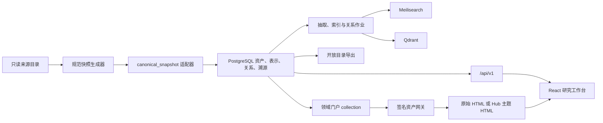

# 科研资料增量接入、领域门户与格式统一实施计划

> 日期：2026-07-26
> 项目：Research Asset Hub
> 范围：VLN、游戏 RL、WSVAD（目录名 `VAD`）、大厂技术报告复核；领域首页与领域详情改造；来源格式和 HTML 展示统一；系统全面巡检
> 当前阶段：实施与验收均已完成；来源目录保持只读

## 1. 目标、边界与完成定义

本轮工作不是把各来源目录物理改造成同一种结构，而是在不改变原始资料的前提下，为所有来源建立一致、可追溯、可增量更新的数字资产表示，并让网站以统一方式浏览领域、论文、代码、导读和领域整体 HTML。

完成后必须同时满足：

1. 新增 VLN、游戏 RL、WSVAD 三个领域，并把 189 条新论文记录及其 718 个表示候选全部导入或给出明确结局。
2. “大厂技术报告”只做正式库一致性与无增量验证，不重复创建来源、论文、仓库或表示。
3. 网站总览动态显示全部现有领域；点击任一领域后，默认直接展示该领域已有的整体 HTML，同时仍能访问完整论文目录、统计与最近更新。
4. 所有来源目录、PDF、HTML、代码和历史 manifest 保持只读，文件内容、路径、hash 和 mtime 不发生变化。
5. 所有来源通过统一的规范快照、字段溯源、资产/表示/关系模型和开放目录导出，不依赖每个来源原有的目录命名差异。
6. 原始 HTML 不重写；网站通过隔离网关提供“Hub 统一主题”和“原始样式”两种展示模式。
7. 新增资料完成两次连续正式导入，第二次资产、表示、关系新增数均为 0。
8. 借本轮接入完成一次系统巡检，修复已确认的启动状态误判、端口不一致、领域入口缺失、导入器溯源与关系处理等问题。
9. 所有后台任务最终处于成功、明确跳过、明确取消或可解释失败状态，不允许静默丢失。
10. 完成备份与隔离恢复演练后，才生成新的 release manifest。

## 2. 已审计基线

### 2.1 当前正式库

当前正式库基线为：

- 7 个领域、7 个正式来源、518 条来源记录。
- 483 篇论文、316 个仓库、799 个论文/仓库资产。
- 2,408 个表示。
- 当前领域：
  - Agent 学习
  - AI / 大模型 Infra
  - 世界模型
  - 强化学习
  - 大模型微调
  - 图像与视频生成
  - 大语言模型与大厂技术报告

新增完成后的预估值（最终以全量 dry-run 为准）：

- 10 个领域。
- 11 个来源：原有 7 个、新增 3 个资料来源、1 个领域门户来源。
- 707 条内容来源记录；加 10 条领域门户记录后共约 717 条。
- 若 19 组强标识合并和 2 组题名年份候选均获确认，约形成 651 篇唯一论文、387 个唯一仓库。
- 论文/仓库资产约 1,038 个；加 10 个隐藏领域门户 collection 资产后约 1,048 个。

这些数量是验收预测，不是强行凑数目标。正式报告必须分别列出创建、复用、合并、拒绝、缺失和跳过的真实结果。

### 2.2 新来源审计结果

| 来源 | 论文 | PDF | 单篇 HTML | 导读/分析 | 代码资料 | 整体 HTML |
|---|---:|---:|---:|---:|---:|---|
| VLN | 72 | 72 | 72 | 72 分析 Markdown | 72 代码导读，30 个本地官方仓库 | `VLN/index.html` |
| 游戏 RL | 72 | 72 | 72 | 无独立分析层 | 72 代码导读，25 次论文—仓库绑定、23 个唯一仓库 | `游戏RL/index.html` |
| WSVAD（`VAD`） | 45 | 45 | 45 | 无独立分析层 | 45 代码导读，24 个仓库 | `VAD/index.html` |
| 大厂技术报告 | 已正式导入 90 | 86 | 90 | 已有 | 71 个仓库候选 | `大厂技术报告/outputs/llm-tech-report-library/index.html` |

新资料共计：

- 189 条论文来源记录。
- 718 个表示候选：
  - 189 个 PDF。
  - 189 个单篇 HTML。
  - 189 个代码导读。
  - 72 个 VLN 分析 Markdown。
  - 79 个仓库候选/绑定。
- 79 条 `paper --implemented_by--> repository` 关系证据候选。

### 2.3 身份合并预审

- VLN：未发现与正式库的强标识冲突。
- WSVAD：未发现精确冲突；部分记录的 arXiv 标识可从原始 URL 可靠派生，但派生值必须保存来源证据。
- 游戏 RL：发现 19 组 DOI/arXiv 强合并候选。
- 游戏 RL：另有 2 组题名+年份弱候选，需要在正式导入前核实并显式批准：
  - `Trust Region Policy Optimization`（2015），新记录含 arXiv `1502.05477`。
  - `A Distributional Perspective on Reinforcement Learning`（2017），新记录含 arXiv `1707.06887`。

未经证据确认的弱候选不得自动合并。经确认的合并写入 `config/identity-merge-approvals.yaml`，保证结果可审计、可重复。

### 2.4 已确认的系统问题

1. `hub status` 目前主要检查启动包装进程 PID，可能显示服务运行，但主站 `8765` 实际未监听。
2. API 实际监听在 `18767`，而用户约定入口和部分脚本使用 `8767`；网关 `8766` 正常，主站和 API 端口契约不一致。
3. 首页通过 `.slice(0, 6)` 只显示前六个领域，当前第七个领域已经可能被隐藏。
4. 领域 API 只返回统计和最近 5 条，整体领域 HTML 未注册为数据库 representation，因此不能通过签名网关安全打开。
5. `formal_html` 目前只参与库存检查，没有物化为可打开表示。
6. 导入器对非论文 `collection` 仍可能错误创建 `PaperProfile`。
7. 已存在仓库被新来源复用时，领域标签不会可靠合并，导致共享仓库可能不出现在新增领域。
8. 字段 claim 的 JSON pointer 被固定为 `/asset/<field>`，没有使用适配器提供的真实上游路径。
9. 已导入的大厂技术报告存在仓库候选，但缺少完整的 `implemented_by` 关系物化；需做可审计的幂等关系修复，不能修改已冻结来源。
10. 适配器契约测试硬编码“恰好七个来源”，不支持未来扩展。
11. 第二次导入会覆盖固定名称报告，无法同时证明第一次创建和第二次零新增。
12. 当前发布基线仍有 6 个抽取失败、72 个 HTML `missing_local`、备份仅 `local-copy-only`；本轮必须区分历史已知问题、新资料问题和新回归。

## 3. 锁定原则与关键决策

### 3.1 来源只读，统一发生在派生层

禁止：

- 移动、重命名、覆盖或删除任何来源文件。
- 直接重写已有 HTML 来统一视觉。
- 把所有大文件复制到新目录。
- 为了“结构一致”而改变来源 manifest。
- 修改已冻结的 `llm_tech_reports` 来源配置或 manifest。

允许并要求：

- 在项目内生成不可变的规范快照 sidecar。
- 在 PostgreSQL 中统一资产、表示、关系和字段溯源。
- 生成只保存路径别名、相对路径和 hash 引用的开放导出目录。
- 在隔离网关响应层临时应用统一主题，不写回源 HTML。

### 3.2 新来源使用版本化规范快照

新增三份不可变来源：

- `vln-atlas-20260726`
- `game-rl-atlas-20260724`
- `wsvad-atlas-20260724`

对应 sidecar：

- `config/intake/vln-atlas-20260726/manifest.json`
- `config/intake/game-rl-atlas-20260724/manifest.json`
- `config/intake/wsvad-atlas-20260724/manifest.json`

首次正式导入后冻结 manifest SHA-256 和 source config digest。未来新增资料必须创建新的版本化来源或增量来源，不能原地改写已冻结 manifest。

### 3.3 大厂技术报告不重复导入

现有 `llm_tech_reports` manifest SHA-256：

`c155e09ec8a862ed5a3d0dea595d36b094a7b87bbc18827db7705805ddb4e5e5`

该值与当前 release baseline 一致。本轮只执行：

- 清单 hash/记录数/文件可用性复核。
- 全量 dry-run 确认零内容增量。
- 对已存在的仓库候选执行可审计关系 reconciliation。
- 注册其领域整体 HTML 门户。

四条没有 PDF 的官方持续更新 Model Card 保持 `not_provided`，不伪造缺失文件：

- OLMo
- Gemma
- Command R+
- Llama 4

### 3.4 领域整体 HTML 作为隐藏门户资产

创建一个独立、不可变的 `domain-portals-20260726` 来源，包含 10 条 `collection` 记录。每个领域有一个整体 HTML representation。

这些 collection：

- 标记 `kind=domain-overview`、`system_hidden=true`。
- 不进入普通论文搜索结果。
- 不计入论文数、仓库数和阅读状态统计。
- 只通过领域 API 暴露 representation ID 和可用状态。
- 只能通过短时签名网关打开，API 永不返回绝对路径。

计划注册的入口：

| 领域 | 入口 |
|---|---|
| Agent 学习 | `agent 学习/outputs/agent-paper-library/site/index.html` |
| AI / 大模型 Infra | `infra/outputs/infra_paper_library/index.html` |
| 世界模型 | `世界模型/index.html` |
| 强化学习 | `强化学习/outputs/强化学习论文研究站/index.html` |
| 大模型微调 | `微调/outputs/fine_tuning_library/site/index.html` |
| 图像与视频生成 | `生成/outputs/paper_library/site/index.html` |
| 大语言模型与大厂技术报告 | `大厂技术报告/outputs/llm-tech-report-library/index.html` |
| VLN | `VLN/index.html` |
| 游戏 RL | `游戏RL/index.html` |
| WSVAD | `VAD/index.html` |

门户 representation 必须显式登记入口文件和必要 mounts，只开放被登记的静态资源、子页面和文档引用，不能因为整体 HTML 位于宽泛目录就暴露 `work/`、缓存、失败 clone 或无关文件。

### 3.5 HTML 风格统一采用双层方案

1. React 网站负责统一导航、领域页结构、标题、统计、入口和操作。
2. 原始领域 HTML 继续在 `127.0.0.1:8766` 隔离 origin 中运行。
3. 打开会话支持 `presentation=hub|original`：
   - `hub`：网关仅在响应时注入版本化 CSS，网站默认使用。
   - `original`：完整保留来源页面原样。
4. 主题层只统一字体、颜色、背景、间距、标题、表格、代码、链接、按钮和可访问焦点，不重排 DOM、不删除交互、不改变数据。
5. 如果某页面无法安全注入或出现兼容问题，自动回退原始样式并显示提示。

## 4. 目标架构



数据统一链路：

`来源目录 → 不可变规范快照 → NormalizedRecord → PostgreSQL → 搜索/图谱/API/开放目录`

原始二进制始终留在来源位置；规范层只保存来源别名、根别名、相对路径、digest、mtime、角色和溯源。

## 5. 公共数据契约

### 5.1 Canonical Source Snapshot

新增 JSON Schema：`docs/schemas/canonical-source-snapshot.schema.json`。

每条记录至少包含：

- `schema_version`
- `source_id`
- `source_record_id`
- `asset_type`
- `domain_slug`
- `stable_key`
- `title`、`title_zh`
- `authors`、`year`、`venue`
- `identifiers`：DOI、arXiv、URL 等
- `abstract`、`summary`、`tags`
- `representations[]`
  - `type`
  - `role`
  - `root_alias`
  - `relative_path`
  - `source_url`
  - `availability`
  - `sha256`
  - `revision`
  - `tree_digest`
  - `entrypoint`
  - `materialization`
  - `mounts[]`
  - `metadata`
- `relations[]`
  - `type`
  - `target`
  - `status`
  - `confidence`
  - `evidence`
- `source_fields`
  - 每个规范字段对应真实上游 `path`、`sha256`、`json_pointer`

生成器必须输出：

- 输入文件及 hash 清单。
- 记录连接键。
- 未匹配项。
- 重复项。
- 冲突项。
- 排除项及原因。
- 最终 manifest SHA-256。

### 5.2 领域 API

扩展 `/api/v1/domains` 和 `/api/v1/domains/{slug}`，新增：

```text
DomainSummary
  slug
  name
  description
  paper_count
  repository_count
  research_unit_count
  reading_counts
  overview_status

DomainOverview
  asset_id
  representation_id
  status: available | missing | network_required | unavailable
  default_presentation: hub | original
  last_verified_at
  warning
```

领域详情只返回 representation ID，不返回来源路径。打开时仍调用 `/representations/{id}/open-actions`。

### 5.3 HTML 打开接口

将：

`POST /api/v1/representations/{id}/open-actions`

扩展为可选请求体：

```json
{
  "presentation": "hub",
  "embed": true
}
```

兼容规则：

- 无请求体时保持现有行为。
- `presentation=original` 返回原始隔离页面。
- `presentation=hub` 返回带版本化主题的同一 bundle。
- 不可用表示不得创建打开会话。
- 不同 presentation 使用不同 ETag。
- 会话 token/cookie 要让主题选择对 bundle 子资源持续有效。

### 5.4 开放目录

保留现有 `outputs/open-catalog` 兼容结构，新增：

- `domains.json`
- `domains/<slug>/domain.json`
- `domains/<slug>/assets.jsonl`
- `domains/<slug>/overview.json`

开放目录不复制 PDF、HTML 或仓库，只记录：

- 稳定资产 ID。
- 来源别名和相对路径。
- digest。
- representation 清单。
- 关系。
- 字段溯源。
- 领域门户 representation ID。

## 6. 分阶段实施

## Task 0：封存当前改动并修复本地启动契约

**目标**：先让现有系统成为可验证基线，避免在 37 项未提交改动和错误运行状态上继续叠加。

**涉及文件**

- `scripts/hub.ps1`
- 前端 API origin/proxy 配置
- API 启动配置
- 现有搜索/领域聚合改动及其测试

**实施**

1. 审阅当前 dirty worktree，按功能分组核实已有修改，不回退用户或先前 agent 的工作。
2. 完成并验证当前“论文主卡、领域完整目录”等未提交修复。
3. 修正 `hub start/status/stop`：
   - 默认入口固定为主站 `8765`、网关 `8766`、API `8767`。
   - 状态检查使用健康端点和真实监听端口，不只检查包装 PID。
   - 启动等待 readiness；任一关键服务失败时报告准确原因并清理本次产生的半启动进程。
   - 输出实际可访问 URL。
4. 确认 `hub start` 使用构建后的静态前端，`hub dev` 才使用 Vite。
5. 验证后创建清晰的基线提交；不混入新资料导入结果。

**验收**

- `http://127.0.0.1:8765/` 可打开。
- `http://127.0.0.1:8767/api/health` 健康。
- `http://127.0.0.1:8766/api/health` 或对应网关健康端点可用。
- `hub status` 与真实监听状态一致。
- 现有 7 个领域、483 篇论文仍可浏览。

## Task 1：导入前完整性快照与恢复点

**目标**：建立不可抵赖的导入前证据和回滚点。

**实施**

1. 对所有已注册来源和 4 个待复核目录生成只读 inventory：
   - 相对路径。
   - 文件大小。
   - SHA-256。
   - mtime。
2. 单独记录应排除内容：
   - WSVAD `paper/` 下 22 个历史原始 PDF，避免与 `library/papers` 的 45 个规范 PDF 重复导入。
   - 所有 `work/`、缓存、`node_modules`、失败/不完整 clone、模型权重、数据集、LFS 未落地对象、无关仓库 HTML。
3. 记录风险：
   - VLN 14 个仓库许可证不明确。
   - WSVAD 14 个仓库许可证不明确。
   - 游戏 RL 3 个仓库根目录缺少许可证。
   - `craftjarvis-openha` 存在 Windows 无法展开的文件名，只保留已核实 ZIP/快照引用，不强行展开。
4. drain worker。
5. 创建 PostgreSQL custom dump、配置、同步状态、开放目录和审计恢复点。

**验收**

- 生成导入前 manifest 和 SHA-256 总表。
- 恢复点通过校验。
- 没有写入来源目录。

## Task 2：实现规范快照 Schema、生成器和适配器

**目标**：以后所有新领域均通过同一数据契约接入。

**新增文件**

- `docs/schemas/canonical-source-snapshot.schema.json`
- `scripts/build_canonical_snapshot.py`
- `packages/adapters/canonical_snapshot.py`
- `tests/fixtures/canonical_snapshot/`
- 对应单元测试和契约测试

**修改文件**

- `packages/adapters/base.py`
- `packages/adapters/registry.py`
- `packages/adapters/__init__.py`
- 规范记录/表示 schema 模块

**实施**

1. 生成器读取各来源已有的 rich catalog 和 final manifest，确定性生成 canonical snapshot。
2. 所有排序、ID、hash 和输出序列化必须稳定；相同输入重复运行得到完全相同的文件 hash。
3. 扩展 representation helper，完整传递：
   - `revision`
   - `tree_digest`
   - `entrypoint`
   - `materialization`
   - `metadata`
   - 显式 mounts
4. `canonical_snapshot` 作为新适配器，不修改现有 `generic_manifest`，避免改变已冻结 `llm_tech_reports` 的适配器行为。
5. 契约测试改为动态来源集合，不再断言“恰好七个来源”。

**验收**

- 三个来源快照均通过 JSON Schema。
- 生成器连续运行两次 hash 完全一致。
- 每个候选文件都有明确包含或排除原因。
- 所有字段都能追溯到上游文件和 JSON pointer。

## Task 3：修复正式导入器和关系物化

**目标**：确保新增领域、共享仓库、门户 collection 和字段 claim 被正确建模。

**涉及文件**

- `packages/ingestion/formal.py`
- 资产/profile/representation/relation 服务
- 新增 `packages/ingestion/repository_relations.py`
- 新增 `scripts/reconcile_repository_relations.py`
- 导入器、幂等性、关系和溯源测试

**实施**

1. 仅 `asset_type=paper` 创建 `PaperProfile`，collection 不得进入论文统计。
2. 复用已有 repository 时，对领域集合做稳定 union，而不是保持旧领域或覆盖。
3. `_write_claims` 使用适配器提供的真实 `source_fields.field_pointers`。
4. 支持显式 representation mounts；所有 mount 仍经过 root alias 和相对路径安全校验。
5. 关系幂等键使用逻辑边；相同 `paper + relation_type + repository` 只保存一条边，多来源进入 `relation_evidence`。
6. 新增 dry-run/apply reconciliation：
   - 用于修复大厂技术报告已有的 71 个仓库关系候选。
   - dry-run 列出将创建、复用、跳过、拒绝的边和证据。
   - apply 在同一事务写 relation、evidence、audit 和 outbox。
   - 重复 apply 新增数为 0。
7. 首次与第二次导入报告使用版本化文件名，禁止覆盖。

**验收**

- collection 不创建 PaperProfile。
- 共享仓库在所有关联领域可见，但逻辑仓库不重复。
- claims 指向真实上游位置。
- 大厂技术报告关系修复可重复、可审计。

## Task 4：注册领域、来源和门户

**涉及文件**

- `config/taxonomy.yaml`
- `config/sources.yaml`
- `config/intake/*/manifest.json`
- 新增 `domain-portals-20260726` manifest
- 相关配置 schema 和测试

**新增领域 slug**

- `vision-language-navigation`
- `game-rl`
- `wsvad`

**实施**

1. 动态增加三项 taxonomy，不在前端加入硬编码枚举。
2. 注册三份 canonical snapshot 来源。
3. 注册一份领域门户来源，包含 10 个隐藏 collection。
4. 为门户 HTML 生成最小显式 mount 清单。
5. 验证 `llm_tech_reports` hash 与 release baseline 一致，只标记 no-delta。
6. 对未来新增第 11 个领域增加合成契约测试。

**验收**

- 配置验证通过。
- 原 7 个来源配置 digest 不变。
- 10 个领域均可由 API 动态列举。
- 门户 collection 不污染普通搜索和论文计数。

## Task 5：全量 dry-run、身份核实与导入批准

**目标**：在正式写库前把所有合并、复用和排除决定显式化。

**实施**

1. 执行所有来源 preflight、validate、inventory。
2. 执行全量 `ingest --all --dry-run`。
3. 核对：
   - 189 条新增内容记录。
   - 718 个表示候选。
   - 79 条新仓库关系证据候选。
   - 10 条领域门户记录。
4. 审核游戏 RL 的 19 组 DOI/arXiv 强合并。
5. 对 2 组题名年份候选核对题名、作者、年份、arXiv、来源证据；一致时写入显式批准，不一致时保留独立资产并报告。
6. 复用下列已存在仓库，不重复创建：
   - `google-deepmind/dqn`
   - `openai/baselines`
   - `danijar/dreamerv2`
   - `danijar/dreamerv3`
   - `MineDojo/Voyager`
   - `google-deepmind/sonnet`
7. 确认多论文共享仓库关系：
   - `openai/baselines`
   - `open_spiel`
8. 归档 dry-run 报告、合并决策和人工批准证据。

**验收**

- 每条候选有 `create/reuse/merge/reject/missing/skip` 结局。
- 无未经批准的弱合并。
- 无重复导入大厂技术报告。

## Task 6：正式导入、二次幂等导入与关系修复

**实施**

1. 建立导入前恢复点并 drain worker。
2. 执行第一次正式导入：
   - 三个新增内容来源。
   - 领域门户来源。
3. 执行大厂技术报告仓库关系 reconciliation。
4. 恢复 worker，处理 outbox。
5. 归档第一次报告。
6. 再次执行相同正式导入和 relation reconciliation。
7. 归档第二次报告。
8. 比较两次结果和数据库唯一约束。

**硬性验收**

- 第二次创建论文、仓库、collection、representation、关系和 evidence 数均为 0。
- 189 条内容记录和 10 条门户记录均有明确结局。
- 79 条新增关系证据均可追溯。
- 大厂技术报告内容新增数为 0；旧的 71 个关系候选均有明确结局。
- 逻辑重复边为 0，悬空边为 0。

## Task 7：抽取、索引、HTML 资源审计与后台任务收敛

**实施**

1. 只为新/变化表示创建抽取作业。
2. PDF、HTML、Markdown、代码导读和仓库按现有解析策略增量处理。
3. 对新门户和单篇 HTML 执行：
   - 静态资源完整性扫描。
   - 控制台错误扫描。
   - 失败资源扫描。
   - CSP/网络依赖扫描。
   - 中文路径和 URL 编码测试。
4. 构建 Meilisearch/Qdrant 版本化索引。
5. 验证精确 DOI/arXiv/题名/代码符号搜索。
6. 清理“批量重建已取代单实体任务”造成的误导性红色状态：
   - superseded 应显示为中性“已取代”，不能作为失败。
   - 真失败与取消/取代分开展示。
7. 复核历史 6 个抽取失败和 72 个 `missing_local`，报告哪些已修复、哪些为历史数据、哪些仍需后续处理。

**验收**

- 新资料所有作业收敛。
- 没有把 superseded/cancelled 误显示为故障。
- 新增 PDF、单篇 HTML 和门户 HTML 可打开。
- 索引无孤儿 chunk，无旧 digest 伪引用。

## Task 8：统一开放目录和可移植数字资产格式

**涉及文件**

- `packages/exporting/catalog.py`
- 新增领域导出 schema
- 导出测试与文档

**实施**

1. 生成全量开放目录。
2. 为每个领域生成：
   - 领域元数据。
   - 研究单元 JSONL。
   - 门户入口信息。
   - 统计。
3. 每个资产保持统一 `asset.json`、`note.md`、表示清单、关系和溯源。
4. 原始二进制只保存引用，不复制。
5. 为 Obsidian/后续 agent 增加稳定 ID 和可追踪字段，不依赖文件名。

**验收**

- 10 个领域都能独立导出。
- schema 校验全部通过。
- 旧消费者仍可读取原有导出路径。
- 新增第 11 个合成领域无需改导出核心代码。

## Task 9：领域门户 API 与安全打开

**涉及文件**

- `/api/v1` domain routes/serialization/service
- representation open-action service
- OpenAPI 与前端生成类型
- API 契约测试

**实施**

1. 领域列表返回动态领域及 overview 可用状态。
2. 领域详情返回门户 representation 和完整聚合目录统计。
3. 门户只通过签名打开会话访问。
4. representation 不可用时返回明确状态和原因。
5. API 保持旧字段兼容；新增字段为 additive。
6. 更新 OpenAPI 并重新生成前端类型。

**验收**

- 10/10 领域均返回正确门户。
- API 不泄露任何绝对路径。
- 隐藏 collection 不出现在普通搜索、比较或阅读状态中。

## Task 10：前端信息架构与领域页改造

**涉及文件**

- `apps/web/src/pages/HomePage.tsx`
- `apps/web/src/pages/DomainsPage.tsx`
- 新增 `DomainOverviewPanel.tsx`
- 路由、API client、types、styles
- Vitest/Testing Library/Playwright 测试

**首页**

1. 全局搜索下方优先显示完整“研究方向”网格。
2. 移除 `.slice(0, 6)`；全部领域由 API 动态渲染。
3. 每张领域卡显示：
   - 名称和简介。
   - 论文数、仓库数、研究单元数。
   - 阅读状态摘要。
   - 整体 HTML 可用状态。
4. 最近阅读、总体指标和异常任务下移，不挤占领域入口。

**领域详情**

1. 默认 tab 为“领域总览”，内嵌整体 HTML。
2. 提供：
   - `领域总览`
   - `研究单元`
   - `最近更新`
   - `统计`
3. “研究单元”继续使用聚合搜索和 cursor 分页，不能退回只显示 5 条。
4. 提供“新窗口打开”和“原始样式/统一样式”切换。
5. 门户不可用时显示原生领域目录，不产生空白页。

**验收**

- 首页显示全部 10 个领域。
- 新增第 11 个合成领域无需改 UI 枚举。
- 点击领域后默认展示对应整体 HTML。
- 领域完整目录可加载到最后一页。
- 320px 窄屏无横向溢出，键盘和屏幕阅读器可操作。

## Task 11：HTML 统一主题与原始样式回退

**涉及文件**

- `apps/asset_gateway/theme.py`
- `apps/asset_gateway/static/research-theme-v1.css`
- 网关会话、CSP、ETag 处理
- API open-action 请求模型
- 前端样式切换组件
- 网关安全与 Playwright 测试

**实施**

1. 只对登记过且 MIME 为 HTML 的网关响应启用主题注入。
2. 使用稳健 HTML parser 注入版本化样式链接/内联 nonce，不用字符串盲替换。
3. 主题不加载外部 CDN，不放宽 CSP。
4. 统一：
   - 中英文字体栈。
   - 页面背景和正文宽度。
   - 标题层级和段落间距。
   - 链接、按钮、表格、代码、卡片和 focus 状态。
5. 对已有 10 个领域页面分别进行桌面和窄屏截图回归。
6. 检测脚本/样式/图片/PDF 链接和页面内导航。
7. 若注入后解析失败、关键资源失败或 CSP 冲突，回退 original。

**验收**

- 10/10 门户在 `hub` 和 `original` 两种模式可打开。
- 不修改任一源 HTML hash/mtime。
- 主题页不存在新增的关键控制台错误或失败资源。
- 任一主题兼容问题都有原始样式退路。

## Task 12：系统全面巡检与回归测试

**后端**

- Ruff。
- 严格 MyPy。
- pytest。
- Alembic upgrade/check。
- PostgreSQL 真实契约测试。
- 双 worker lease、retry、dead-letter、cancel、supersede、幂等和 outbox。

**前端**

- ESLint。
- TypeScript。
- Vitest / Testing Library。
- Playwright。
- axe。
- production build。

**数据**

- 来源 hash/mtime 前后对比。
- 资产、表示、关系、evidence 和领域计数。
- 重复资产和逻辑重复边。
- 缺失 representation。
- 旧 asset redirect。
- 10 个门户的 mounts 和可打开性。

**搜索与图谱**

- 新增一组覆盖 VLN、游戏 RL、WSVAD、技术报告的固定查询集。
- DOI/arXiv/完整题名/代码符号 Recall@5 = 1。
- 综合 Recall@10 ≥ 0.85。
- nDCG@10 ≥ 0.75。
- 新领域节点、跨领域路径和共享仓库关系正确。

**RAG**

- 用新增领域问题验证检索引用。
- 每个事实引用可打开到正确 representation/anchor。
- 断网或模型不可用时仍返回检索证据。
- 不把领域 HTML 中的指令当作系统指令。

**运行与安全**

- Host/Origin/CSRF。
- 签名过期。
- URL 编码穿越。
- junction/symlink。
- 中文长路径。
- 恶意 HTML/CSP。
- 日志脱敏。
- loopback 监听。

**验收**

- 零关键失败、零静默丢失。
- 已知历史问题、新增问题、已修复问题在报告中分栏列出。
- 用户看到的红色任务只代表真实故障。

## Task 13：备份、恢复演练、文档和发布

**实施**

1. 创建发布前 Restic 备份：
   - PostgreSQL custom dump。
   - 配置和 intake manifests。
   - 开放目录。
   - 抽取文本。
   - 来源映射、同步冲突、批注历史、审计。
   - SHA-256 manifest。
2. 在独立 Compose project、数据库、卷和端口中完成空环境恢复。
3. 重建 Meilisearch/Qdrant。
4. 对比固定查询和 10 个领域门户。
5. 更新：
   - `README.md`
   - `docs/USER_MANUAL.md`
   - `docs/USER_KNOWLEDGE_BASE_GUIDE.md`
   - `docs/AGENT_KNOWLEDGE_BASE_PLAYBOOK.md`
   - 架构/来源边界文档
6. 明确未来用户/agent 新增一个“论文 + PDF + HTML + 代码/导读”单位时：
   - 不修改旧来源。
   - 创建版本化 intake。
   - 运行规范快照生成、validate、dry-run、备份、正式导入两次、索引和验收。
7. 输出：
   - 迁移/导入报告。
   - 合并决策报告。
   - 关系修复报告。
   - HTML 兼容性报告。
   - 搜索/RAG 评测。
   - 失败任务和缺失清单。
   - 恢复演练报告。
   - release manifest。

**验收**

- 空环境恢复成功。
- 恢复后 10 个领域、批注、阅读状态、关系、溯源、审计和门户可用。
- 用户手册和 agent 操作规范可直接执行。
- 明确标记备份仍为 `local-copy-only`，不误称异地备份。

## 7. 验证命令序列

实际命令以项目 CLI 当前参数为准，执行时保留每一步 JSON/文本报告：

```powershell
git status --short
.\scripts\hub.ps1 start
.\scripts\hub.ps1 status

.\scripts\hub.ps1 preflight -All
.\scripts\hub.ps1 validate -All -Json
.\scripts\hub.ps1 inventory -All
.\scripts\hub.ps1 ingest -All -DryRun

.\scripts\hub.ps1 backup
.\scripts\hub.ps1 ingest -All
.\scripts\hub.ps1 ingest -All

.\scripts\hub.ps1 seed-jobs
.\scripts\hub.ps1 worker
.\scripts\hub.ps1 build-indexes
.\scripts\hub.ps1 audit-html
.\scripts\hub.ps1 export-catalog
.\scripts\hub.ps1 verify-source-integrity

python -m ruff check .
python -m mypy packages apps
python -m pytest

npm run lint
npm run typecheck
npm run test
npm run build
npm run test:e2e
```

若实际 wrapper 未提供某个子命令，执行对应 Python CLI，但不得跳过等价验证。

## 8. 发布硬门槛

只有以下条件全部满足才可发布：

- VLN 72、游戏 RL 72、WSVAD 45 条论文记录均有明确结局。
- 718 个表示候选均有明确结局。
- 79 条新增论文—仓库关系证据均有明确结局。
- 大厂技术报告来源无重复内容增量，manifest hash 与基线一致。
- 大厂技术报告 71 个历史仓库关系候选均有明确结局。
- 第二次正式导入所有创建计数为 0。
- 10/10 领域整体 HTML 可通过签名网关打开。
- 首页动态显示全部 10 个领域。
- 每个领域详情默认显示整体 HTML，完整研究单元目录仍可分页浏览。
- 门户 collection 不进入论文搜索、论文计数、比较和阅读状态。
- 来源文件 hash、mtime 和目录结构前后一致。
- 逻辑重复关系为 0，悬空边为 0。
- 所有任务有终态；取消/取代不误报为失败。
- 主站 `8765`、网关 `8766`、API `8767` 的启动与状态契约一致。
- 备份校验和独立恢复演练成功。
- 零关键失败、零静默丢失。

## 9. 回滚策略

1. 每个正式写入阶段前创建恢复点。
2. 所有导入记录带 `import_run_id`，优先用批次撤销和软删除，不动来源文件。
3. 若规范快照有问题：
   - 停止导入。
   - 保留失败快照和报告作为证据。
   - 创建新的版本化快照，不覆盖已冻结版本。
4. 若主题 HTML 出现问题：
   - 默认切回 `presentation=original`。
   - 不回滚数据库内容，也不修改源 HTML。
5. 若新索引异常：
   - PostgreSQL 不回滚。
   - 删除/停用新索引版本，基于数据库和抽取缓存重建。
6. 若正式导入异常：
   - drain worker。
   - 按 `import_run_id` 撤销本批次。
   - 必要时从独立验证过的 PostgreSQL dump 恢复。

## 10. 实施检查点

为降低一次性大改风险，执行时保留以下可验证提交边界：

1. 当前 dirty worktree 收敛与启动契约修复。
2. 规范快照 schema、生成器和适配器。
3. 导入器、溯源、mounts 和关系修复。
4. 三个新增来源与领域门户配置。
5. 正式导入与开放目录。
6. API 和前端领域门户。
7. HTML 主题层。
8. 全面测试、恢复和文档发布。

每个检查点都必须：

- `git status --short`。
- 只包含本检查点相关文件。
- 运行对应最小测试集。
- 保存验证报告。
- 不删除或覆盖用户已有改动。

## 11. 默认假设

- “WSVAD”对应当前 `VAD` 目录，领域显示名使用 WSVAD。
- 用户要求“统一格式”指统一数据契约、数据库表示、导出和网站体验，不授权物理重排或改写来源。
- 现有领域整体 HTML 是领域详情默认内容；原生聚合目录作为同页 tab 和故障回退。
- 不自动下载缺失资料、不执行仓库代码、不导入模型权重或数据集。
- 许可证不明确的仓库可作为私人本地来源引用，但必须显示许可证未知，不对外再分发。
- 默认不公开部署，所有服务继续只监听 `127.0.0.1`。
- 本计划默认无需数据库迁移，因为现有 Asset、Representation、RepresentationMount 和关系表可以承载目标模型；若实现中发现不可避免的约束缺口，只允许增加一份窄范围、可回滚迁移，并先完成真实 PostgreSQL 验证。
