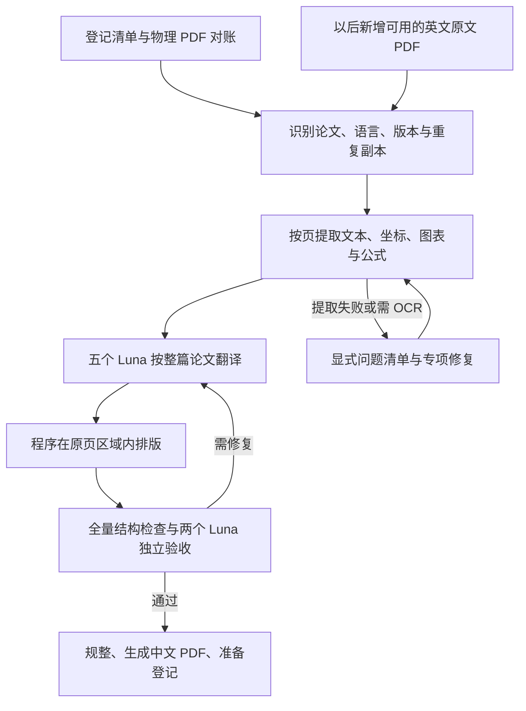

# 核心领域论文逐页中文 PDF 翻译规划

日期：2026-09-30  
状态：供用户审阅的实施规划，尚未开始批量翻译、程序开发或知识库写入。  
范围：`D:\ResearchLibrary` 下的全部英文论文及研究技术报告 PDF，包括尚未登记到 Hub 的正式资料。  
执行团队：一位主 agent 调度，另调用 **八个 `gpt-6-luna` 子 agent，思考程度为 `max`：五个翻译、两个验收、一个规整**。

## 1. 目标和必须满足的条件

建立一套可以重复运行、断点续跑的程序，完成“论文盘点 → 按页提取 → 中文翻译 → 原页排版 → 独立验收 → 译文登记”。先覆盖现有论文，再把新增论文接入相同流程。

最重要的要求是：**原 PDF 第 n 页的内容，翻译后仍在中文 PDF 第 n 页。** 这里的页码指 PDF 的物理页序，包含首页、参考文献和附录；同时保留原文件已有的印刷页码。

以下是硬约束，不能为了让程序继续运行而放宽：

1. 中文 PDF 与原 PDF 页数相同，页面尺寸、裁切框和旋转对应。
2. 每个源文本片段有固定的来源页和唯一 ID；译文不得跨页搬移、遗漏、重复或改变论证顺序。
3. 原本跨页的句子或段落，可以一起提供上下文，但属于不同页的片段仍分别排回原页。不能把整个跨页段落合并到一页。
4. 翻译是完整翻译，不得通过摘要、删句或省略限定条件解决版面溢出。
5. 公式、实验数字、单位、引用编号、图表数据和算法逻辑保持正确。
6. 中文可搜索、可复制；文字完整可读，没有缺字、遮挡或裁切。
7. 来源 PDF、既有 manifest 和冻结来源配置保持只读。译文另存，并关联到原论文。
8. 无法满足条件的论文保留在失败或待修复清单中，不能被标为“全部完成”。

**同页不等于中文与英文每一行的像素位置完全相同。** 中文断行和行高会改变，允许在原页的安全区域内调整排版，尽量保持原来的栏结构与段落区域。任意 PDF 都能完全自动、无人工修复地满足全部要求，目前没有依据作出这种保证；扫描件、图内小字和极密集版面需要专门处理。

## 2. 当前已经核实的情况

以下信息来自 2026-09-30 的只读文件与代码检查，没有查询运行中的数据库。

| 检查项 | 发现 | 对实施的影响 |
| --- | --- | --- |
| 物理 PDF | 排除环境目录后有 1,774 份；进一步排除 `upstream`、`code`、`repos`、`incomplete-clones` 路径后有 1,347 份候选 PDF | 文件数包含副本、历史文件和非论文内容，不能直接当作翻译数量；被排除的目录仍需核对是否有唯一正式论文 |
| 已登记论文快照 | 2026-09-12 的开放目录记录 1,110 个 `paper` 资产；其中 1,106 个含 PDF 表示，共 1,220 条 PDF 表示 | 这是登记快照，不是当前英文论文的精确总数；应与物理目录对账 |
| PDF 可用状态 | 上述快照中 1,186 条 PDF 表示为 available，34 条为 missing | 状态需重新核查；34 是表示数量，不是缺失论文数量 |
| 多份 PDF | 103 个论文资产有多条 PDF 表示；SHA 元数据中有 54 组重复组 | 相同内容只翻译一次；不同内容要核对是否为修订版、会议版或补充材料 |
| 提取能力 | 本机有 PyMuPDF 1.28.0、pdfplumber、pypdf 和 Poppler；部分现有脚本只提取并拼接全文，没有段落 bbox | 必须新增按页、按区域提取，不能直接拿已有全文文本生成译稿 |
| OCR | 未发现可用的 Tesseract 命令或所检查的 OCR 包 | 扫描区域需先配置并验证 OCR；不能把扫描页空文本当作无内容 |
| Hub 作业机制 | 已有持久作业表、去重、租约、心跳、重试和 Outbox 事件 | 可复用，不另建一套独立消息队列 |
| 翻译接线 | 当前没有翻译 handler；入库后的表示抽取仍需要 seeder 排队 | 自动同步需要补齐“入库到提取到翻译”的触发链 |
| 派生 PDF | 表示模型已有 `pdf` 类型、`derived` 角色和 JSON attributes | 可复用表示机制；语言、验收状态及明确的中文入口需要补充 |

还未知的量包括：实际英文论文数、唯一源 PDF 数、总页数、扫描/复杂图表页占比，以及 2026-09-12 后尚未反映在开放目录的资料。实施第一阶段要产生这些统计，不按旧 README 数字推算全部工期。

## 3. 八个 Luna 的分工

主 agent 负责程序实现、任务分配、技术决策、进度汇总和最终交付；主 agent 不计入八个 Luna。八个子 agent 直接服务于翻译生产，不能全部安排成调查或代码开发人员。

| 子 agent | 工作 | 写入范围 | 交付 |
| --- | --- | --- | --- |
| Luna T1 | 翻译分片 1 | 自己领取的整篇论文的译文 JSON 和返工记录 | 完整译文、术语候选、问题清单 |
| Luna T2 | 翻译分片 2 | 同上，任务与其他翻译者互斥 | 同上 |
| Luna T3 | 翻译分片 3 | 同上 | 同上 |
| Luna T4 | 翻译分片 4 | 同上 | 同上 |
| Luna T5 | 翻译分片 5 | 同上 | 同上 |
| Luna Q1 | 独立验收论文组 1 | 自己领取的论文的验收报告 | 逐页覆盖、语义和版面问题、通过/返工结论 |
| Luna Q2 | 独立验收论文组 2 | 与 Q1 不重叠的验收报告 | 同上 |
| Luna R1 | 规整与登记准备 | 合并清单、术语裁决草案、交付目录、待导入旁车和汇总报告 | 可追溯的中文 PDF 库及登记材料 |

两位验收者各自承担完整的验收职责，按论文分流，不能一个只检查页数、另一个只检查几个摘要。整理者不自行改写科学内容；内容问题返回翻译者，修改后由验收者复查。

调度单位以**整篇论文**为主，按页数和难度均衡分给五位翻译者；完成后可以领取下一篇。单篇内部按章节或小节分批翻译，并保存页面片段级检查点。不要把同一论文相邻页面交给不同翻译者独立翻译。

需要调整吞吐量时，可在四到六个翻译者之间重分工，但子 agent 总数保持八个。默认采用 5/2/1；任何调整都记录在运行清单中。验收积压时先控制新翻译任务，不能跳过验收。

执行主 agent 应告诉所有子 agent：它们共享工作区，不得覆盖他人输出、修改来源文件或改动自己范围之外的程序。任务分配和归属只由主 agent 更新，子 agent 写各自独立的结果文件。

## 4. 程序流程和中间数据



建议新增一个集中工具目录 `tools/paper_translation/`，提供盘点、提取、生成任务包、合成、验收和续跑入口。程序负责文件与版面处理，模型负责翻译和语义核对，避免让模型自由生成整份 PDF 的分页结构。

每个文本单元至少保存以下数据：

```json
{
  "paper_id": "稳定论文标识",
  "source_pdf_sha256": "源文件内容摘要",
  "page_index": 0,
  "printed_page_label": "1",
  "unit_id": "p0001-u0012",
  "kind": "paragraph",
  "reading_order": 12,
  "bbox": [54, 120, 293, 240],
  "source_text": "原文片段",
  "paragraph_id": "para-003",
  "continuation_id": null,
  "protected_spans": [],
  "translation_zh": "对应中文片段",
  "review_status": "pending"
}
```

`page_index` 从 0 开始，用户报告显示从 1 开始的物理页码。页面级数据另外保存 MediaBox、CropBox、旋转及坐标系。来源页、源 ID、原文和保护区在翻译阶段不可修改；模型只返回相同 ID 下的译文和疑问。

跨页段落同时保存逻辑段落与各页片段。模型可以读取完整句段作为上下文，但返回的译文必须分别对应这些固定片段。跨页语义分配不可靠时进入复核，不能把“有页码锚点”当成已经满足同页要求。

缓存键至少包含源 PDF SHA、目标语言、提取/排版流程版本、模型与提示词版本、术语表摘要。模型调用还应绑定文本单元及必要上下文的摘要。保存成功的提取结果、译文和验收记录；中断后只重做失效或失败单元。

### 4.1 提取

- 原生文本 PDF：以 PyMuPDF 的 `rawdict` 提取字符、span、行、块及坐标；pdfplumber 辅助表格与字符几何核查。
- 双栏/多栏：先识别阅读栏，再在栏内排序；跨栏标题、通栏图表和脚注单独处理。不能简单全页按 y 坐标排序。
- 扫描与混合页：逐区域判断是否需要 OCR；保留 OCR 原文、定位和置信度。低置信度文字必须对照页面图像核验。
- 公式和图片：建立保护区，保存原公式、矢量图形与图像的对应位置。行内公式也要保护，不能仅保护独立大公式。
- 图内文字：无论能否从文本层提取，都建立清单；位图内英文需要 OCR 和局部处理，不能因为不在正文文本层里就漏掉。

PyMuPDF 提供字符及区域坐标，但 PDF 默认文本顺序不一定是自然阅读顺序，需额外处理多栏。[官方提取说明](https://pymupdf.readthedocs.io/en/latest/app1.html)

### 4.2 翻译内容与术语

全文范围包括题名、摘要、正文、章节标题、图注、表头及文字单元格、图例和坐标轴、脚注、算法自然语言说明、公式解释、参考文献题名及附录。

以下内容按学术用途保留原样：作者姓名、模型/方法/数据集专名、程序标识符、真正代码的语法、数学符号、实验数字、引用编号、DOI、arXiv ID 和 URL。参考文献题名提供中文，原始题名保存在双语对照记录中；作者、刊物/会议名称、年份和卷期页码保持可核查。

五位翻译者共享基础术语表及领域术语表。并行批次使用同一冻结版本，新术语以候选记录提交，主 agent 结合规整者的草案裁决；必要时回查已有译文。保留否定、条件、比较对象及 may、only、up to 等限定语，不把谨慎结论翻成确定结论。

正文、图内文字和参考文献不能通过未经说明的“豁免”排除。图内英文无法安全替换时，可在**同页且靠近该图的可用区域**提供明确对应的中文标注；如果本页没有足够空间或对应关系不清楚，仍视为待修复，不能算全译通过。

### 4.3 原页排版

优先保留原页面里的图片、公式和矢量图形，只替换经确认的英文文本区域，嵌入可覆盖中文及所需符号的字体。需要删除原文时，必须防止误伤相邻公式、图形和表格线；不能简单用白色矩形盖住整段后忽略底下的内容。

排版调整顺序为：使用原区域 → 调整中文换行与合理行距 → 利用本页的安全空白 → 在试点确定的字号下限内调整字号 → 专项修复。正文和脚注的字号下限分别制定，并写入配置，不使用无限缩小字体的办法。

排版器必须返回是否完整容纳文字；保存后重新打开、提取中文文本并渲染检查。PyMuPDF 的文本框接口可以报告放不下的情况，普通文本插入不能替代适配检查。[官方文本框说明](https://pymupdf.readthedocs.io/en/latest/shape.html)

扫描文字已包含在图片像素中，擦除旧字可能损坏背景和公式。这类页面按专项流程处理，不能以整页 OCR 后重新排正文就声称保留了原图和版面。PDFMathTranslate/BabelDOC 可作为试点候选比较，但不得绕过本规划的同页验收；是否采用在样本实测后决定。

## 5. 验收和“完成”的定义

验收分为程序全量检查、独立语义复核和渲染后的视觉检查。**页数相等、区块覆盖率 100% 都不能单独证明译文正确。**

| 验收层 | 检查范围 | 不通过的典型情况 |
| --- | --- | --- |
| 来源完整性 | 全部源文件和冻结来源 | 原 PDF 或既有 manifest 被修改 |
| 页面对应 | 全部页面 | 页数/几何变化、错序、重复页、内容跨页搬移 |
| 内容覆盖 | 全部文本单元、图内标注和附录 | 没有译文、重复译文、整段被摘要化、扫描文字未识别 |
| 数字与保护内容 | 全部已识别公式、表格数字、编号、单位、实体 | 数值/单位/比较方向改变、公式关系受损 |
| 排版检查 | 全部页面自动检测 | 越界、裁切、缺字、重叠、覆盖保护区、字号低于下限 |
| 语义复核 | 每篇的全部待译单元，重点复查方法、结果、结论和限制 | 否定/条件丢失、术语错用、结论范围扩大 |
| 视觉检查 | 试点逐页；全量阶段按下述规则 | 图表被遮挡、OCR 修补损坏、文字不可读 |

两位验收者对分给自己的论文逐段做独立双语复核。只完成自动检查或抽样语义阅读的文件，必须显示为相应的未完整验收状态，不能标为最终完成。

试点 PDF 逐页检查渲染图。全量阶段每篇至少检查首页、末页和正文分层样页；所有复杂公式/表格、图内文字、跨页段落、OCR 低置信度及自动告警页必查。普通视觉样页可从 `max(3, ceil(总页数 × 10%))` 起步，上限为总页数；发现漏译、错位或裁切后，该篇扩大为逐页检查，并回查使用相同版面处理规则的其他论文。视觉抽样是有残余风险的检查，报告必须注明范围。

问题记录至少包含：论文 ID、源 SHA、页码、文本单元 ID、类型、严重程度、证据、责任人、重试次数及关闭状态。影响含义或完整性的缺陷必须修复；同页要求没有例外。

论文状态建议为：`pending`、`extracting`、`translating`、`composing`、`reviewing`、`needs_fix`、`failed`、`accepted`。文件是否可访问与翻译是否通过验收是不同状态，不能混用。只有 `accepted` 可作为已完成中文论文展示。

所有候选必须在最终清单中有结局：完成、相同 SHA 的重复副本复用、已是中文、非论文、缺失、损坏、待 OCR、待修复或失败。状态分类不改变“应翻译论文必须最终满足要求”的目标，不能用分类静默缩小范围。

## 6. 存储、规整和 Hub 登记

建议中文 PDF 使用一个新的稳定目录，例如：

```text
D:\ResearchLibrary\中文译文\
  <source_pdf_sha256>\
    <translation_version>\
      paper.zh-CN.pdf
      bilingual.jsonl
      provenance.json
      qa.json
```

这是拟定目录，实施前检查它不落在任何已冻结来源根内。中间提取结果、任务包、预览和失败记录放在可重建工作区，例如 `work/paper-translation/<run-id>/`；它们不作为正式论文资产。译文 PDF 不复制进 Hub 的 Git 仓库。

同一 SHA 的多个副本共享一个译文，并保留全部来源映射。不同 SHA 不自动认定是不同版本，也不自动丢弃；先检查内容和版本，确认不同的正式版本分别绑定译文。只因 PDF 元数据或压缩方式不同而产生的哈希变化，需要内容比较后决定是否可复用。

登记尽量使用现有机制：

- 在原论文资产下新增 `representation_type: pdf`、`role: derived` 的表示；不要创建一篇独立“中文论文”资产。
- 译文属性记录 `language: zh-CN`、`derivation_kind: translation`、源 PDF SHA、流程/术语/模型版本、验收状态和显示标签。
- 每个完成批次建立新的旁车 source 与外部 `asset_roots`；正式导入后，该批次 manifest 和 source 配置冻结。下一批建立新 source，不能往旧批次追加。
- 用 DOI/arXiv 等强标识匹配原论文；没有强标识时走项目已有的明确匹配审核，不凭文件名或中文题名合并。
- 按现有项目规范完成 dry-run、备份、正式导入两次、完整性校验和网站打开检查；不得直接写数据库绕过这些流程。
- 入口明确显示“原文 PDF”和“中文 PDF”，并显示版本与验收状态；检查搜索卡片和详情页都能选对表示。

当前 generic adapter 的表示元数据映射和前端选择行为需要实施时补充确认。优先用已有 JSON attributes，不先增加专用语言数据库列。若采用专用派生表示登记 API，必须实现审计和受控路径校验；本规划不把尚不存在的 API 当成现成能力。

## 7. 以后新增论文如何自动同步

“自动同步”的目标是：新增或新增版本的可用英文原文 PDF 正式登记后，自动排入提取、翻译、排版和验收流程，通过后自动关联中文表示。翻译不放在导入事务里长时间执行；导入只可靠地记录待处理任务。

最小接线方案：

1. importer 确认新增/变化的原文 PDF 表示时，在同一事务写入表示级 Outbox 事件。
2. worker 根据事件排入按页结构提取任务，不能依赖用户每次手工运行 `seed_jobs.py`。
3. 提取成功后排入翻译任务，使用统一去重键；既有论文回填和以后新增使用相同规则。
4. 翻译完成后依次排版、检查、验收；只有通过才进入规整和派生表示登记。
5. 启动/续跑时做任务对账，补齐“原文已登记但相应版本没有中文译文或任务”的情况。
6. 只响应需要翻译的原文 PDF；中文派生 PDF、代码、HTML 及其他资料不会再次触发翻译，避免递归生成。

现有作业表可以复用。需要增加翻译任务类型、handler、事件派发和消费者范围约束；当前 worker 没有任务类型过滤，不能简单启动多个通用 worker 就宣称实现了五翻译、两验收、一规整。并发领取使用已有租约/行锁机制，长任务持续心跳；输出原子落盘，旧租约返回结果不得覆盖新任务。网络临时失败有限重试；确定性的 OCR、排版或语义问题进入 `needs_fix`，不无限盲重试。

必须区分两种运行方式：

| 方式 | 执行者 | 能力与前提 |
| --- | --- | --- |
| 首次批量执行 | 用户交给主 agent，由它实际调用八个 Luna 子 agent | 完全按本规划的 5/2/1 分工；本地程序提供任务包、排版和记录 |
| 持续自动同步 | 长期运行的 worker 加可程序调用的模型/agent 入口 | 必须配置并实测模型访问、鉴权、限流、费用和验收执行；电脑/服务停止时任务保留，恢复后续跑 |

当前对话里的协作工具不是普通 Python 脚本可直接调用的接口，也不会因为把规则写入 Markdown 就长期运行。自动模式可用程序化 agent 运行入口，或用 Responses API 实现同样的五翻译、两复核、一规整职责；后者是八个逻辑工位，不应称为已经启动了当前桌面会话的八个子 agent。

OpenAI 官方文档确认 `gpt-6-luna` 支持 `max` 思考程度和结构化输出，可作为 API 模式候选。[Luna 官方模型文档](https://developers.openai.com/api/docs/models/gpt-6-luna) 不预设当前桌面订阅已提供后台 API 资格或费用额度；实际入口在实施自动同步阶段核实。未接通模型消费者时只能称为“自动排队”，不能称为“自动翻译完成”。

## 8. 分阶段实施与交付

| 阶段 | 工作 | 交付与通过条件 |
| --- | --- | --- |
| A：盘点和规范 | 对账清单与物理 PDF；识别英文/版本/重复/扫描；确定术语和字号规则 | 每个候选有身份与结局；得到唯一源 PDF 和页数统计 |
| B：程序与小规模试点 | 实现提取、任务包、合成、校验和续跑；按 5/2/1 启动八个 Luna | 试点 PDF 全文翻译，逐页同页验收通过；中断恢复和重复运行不产生重复产物 |
| C：全量翻译 | 五位翻译者均衡处理，两个验收者独立检查，规整者准备交付 | 全量清单收敛；失败/待修复仍显式列出，不宣称全部完成 |
| D：平台登记与入口 | 新旁车批次、派生表示、原文/中文切换及来源完整性检查 | 同一论文可安全打开原文和验收通过的中文版本，导入幂等 |
| E：新增自动同步 | 接通 Outbox、worker 和可长期调用的模型入口；落实项目规则 | 新增论文自动完成全流程，失败可见；重启续跑，不递归翻译派生 PDF |

试点建议选 8 篇，覆盖不同版式；下面是候选，开工前确认实际版面，不把论文名称当作版式证据：

| 候选 | 主要检查目标 | 原 PDF 路径（相对核心领域） |
| --- | --- | --- |
| StreamingTOM | 图内文字与复杂插图 | `VLM框架3DV压缩/library/papers/streamingtom-2026/paper.pdf` |
| FastV | 单栏候选和公式 | `VLM框架3DV压缩/library/papers/fastv-2024/paper.pdf` |
| Qwen2-VL | 长文及附录候选 | `VLM框架3DV压缩/library/papers/qwen2-vl-2024/paper.pdf` |
| 多模态 WSVAD 综述 | 长文、多表格、术语一致性 | `VAD/library/papers/survey-multimodal-wsvad-2025/paper.pdf` |
| Diffusion Models 综合综述 | 长文、公式与图表 | `生成/outputs/paper_library/papers/diffusion-models-a-comprehensive-survey-of-methods-and-applications/paper.pdf` |
| ToMe | 方法公式和实验表格 | `VLM框架3DV压缩/library/papers/tome-2023/paper.pdf` |
| BERT | 会议论文正文与实验表格 | `微调/outputs/fine_tuning_library/papers/A2_bert/paper.pdf` |
| MOME | 短篇高密度双栏候选 | `VAD/library/papers/mome-2026/paper.pdf` |

如果这些候选没有覆盖扫描件或跨页表格，从盘点中替换一篇，保持试点规模约 8 篇。先对版式困难页做排版可行性实验，再翻译试点全文。

费用和工期在试点后估算，记录各类页面的提取/OCR、模型输入输出与推理用量、排版、验收、返工耗时。按难度分层计算，不能把总工时简单除以八；翻译只有五个工位，验收和规整也可能形成等待。使用 API 时按实际账单口径计费，包括缓存、推理和重试；使用桌面子 agent 时以可用额度和实测速率为准，不混用两种计费口径。

## 9. 后续要写入项目规范的规则草案

以下内容在实施阶段写入项目 `AGENTS.md`、`prj.md`、用户入库指南和 agent 操作手册，并链接本规划；当前只提供草案，不修改这些既有文件。

> 凡新增或补充可用英文论文/研究报告 PDF，必须自动排入逐页中文翻译流程。中文译文作为同一论文的派生 PDF，绑定原 PDF 的内容摘要与版本。原文、既有 manifest 和冻结来源配置保持只读；译文写入独立的受控目录。译文页数、页面几何和内容来源页必须与原文对应，图表、公式、数字及引文保持正确。翻译、排版和独立验收全部通过后才可标为完成。失败、待 OCR、待修复和缺失必须可见。新增资料任务的完成报告必须包含中文译文状态，不能把“已排队”或“PDF 文件已生成”当作翻译完成。中文派生表示不再次触发翻译；代码、HTML 等非论文 PDF 资产不强行转换为中文论文。

## 10. 给执行主 agent 的启动说明

本文件是规划，用户审阅后明确要求执行才开始实施。阅读规划本身不授予 commit、push、发布、模型付费调用或其他额外外部写入权限；程序开发、翻译和正式登记分别遵循届时用户授权及项目边界。

收到执行指令后，主 agent 按以下顺序工作：

1. 阅读本规划、项目 `AGENTS.md`、`prj.md` 及其中要求的入库文档；运行 `git status --short`，保留现有大量未提交改动。
2. 完成最小程序和盘点，不先让八位 Luna 漫无范围地扫描目录。
3. 为试点建立不可变来源清单、术语表、逐页提取结果、五份翻译任务包、两份验收队列和规整任务说明。
4. 实际调用八个 `gpt-6-luna`、`max` 子 agent，按 T1–T5、Q1–Q2、R1 分工；不要替换成八位调查者，也不要额外创建用户侧新聊天代替子 agent。
5. 明确每位子 agent 的论文归属、写入范围、禁止改动来源、共享工作区注意事项和交付格式；主 agent 完成合成程序与集成验证。
6. 试点通过后逐步扩大任务，保持 5/2/1，并以结构化记录续跑。规整者不能在其他人仍写文件时提前宣布全量完成。
7. 输出可直接阅读的中文 PDF、双语对应记录、验收结果和全量状态清单；按授权完成 Hub 登记，再接入新增同步。

## 11. 本规划的依据与阅读入口

项目文件均相对 `research-asset-hub`：

- [项目 agent 规范](../../AGENTS.md)、[入库强制规则](../../prj.md)。
- [来源边界](../architecture/source-boundaries.md)、[agent 入库手册](../AGENT_KNOWLEDGE_BASE_PLAYBOOK.md)、[用户新增资料指南](../USER_KNOWLEDGE_BASE_GUIDE.md)。
- [开放目录快照](../../outputs/open-catalog/manifest.json)、[开放目录记录](../../outputs/open-catalog/catalog.jsonl)：本次论文候选和表示数量依据。
- `packages/ingestion/formal.py`：表示登记与 `asset.imported` 事件。
- `apps/worker/main.py`、`apps/worker/handlers.py`、`apps/worker/lease.py`：事件派发、抽取/索引处理器和作业租约。
- `packages/domain/platform_models.py`、`scripts/seed_jobs.py`：作业模型、去重键与现有抽取排队入口。
- `packages/domain/models.py`、`packages/domain/enums.py`、`packages/adapters/generic.py`：派生表示和旁车映射。
- `apps/asset_gateway/registry.py`：受控路径根；`apps/web/src/components/ResearchUnitActions.tsx`、`apps/web/src/pages/AssetDetailPage.tsx`：PDF 入口和选择行为。

这些是本次静态检查的接入点，实施时按工作树实际内容复核。没有运行中的数据库状态、完整扫描件占比或实测试点数据时，不作全量耗时和成功率承诺。
